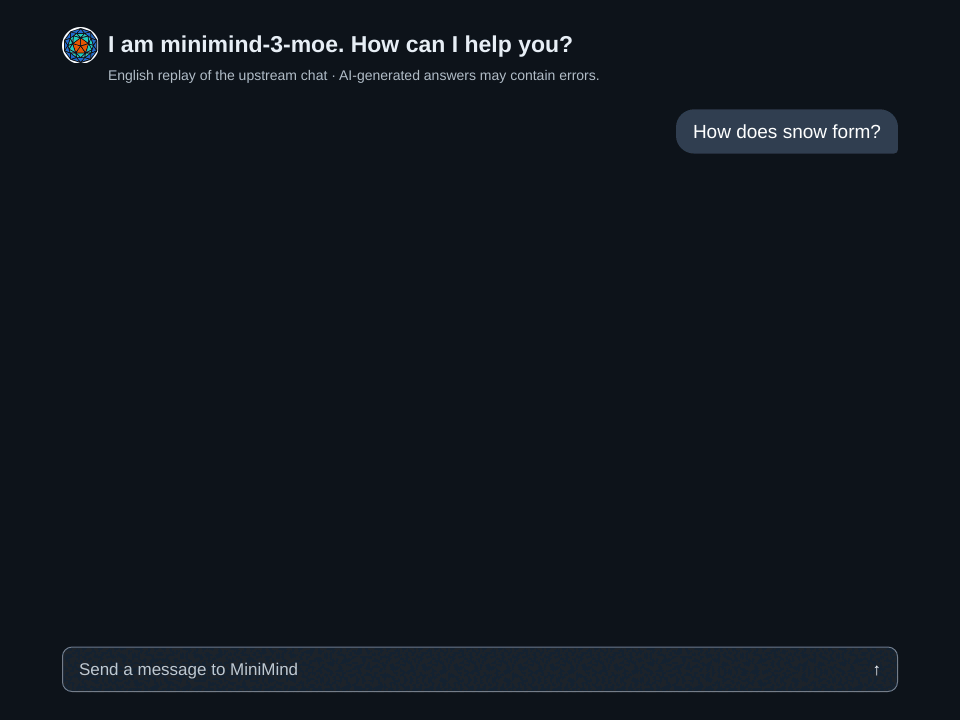
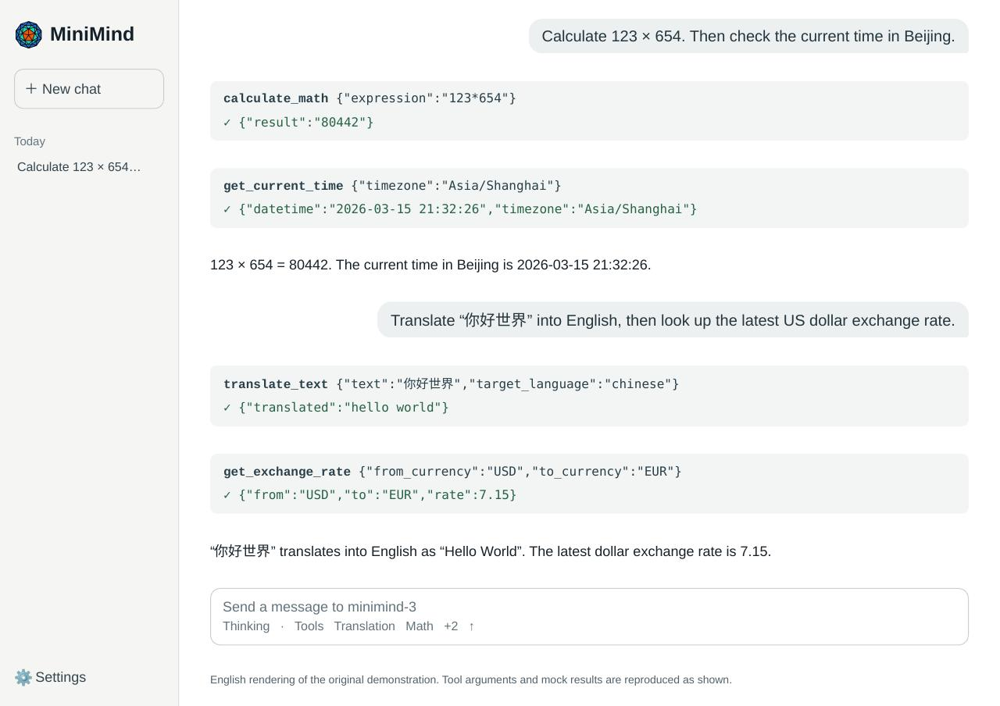

<div align="center">


</div>

<div align="center">


[](https://github.com/UPerna/minimind/stargazers)
[](LICENSE)
[](https://github.com/UPerna/minimind/commits/master)
[](https://github.com/UPerna/minimind/pulls)
[](https://huggingface.co/collections/jingyaogong/minimind-66caf8d999f5c7fa64f399e5)

</div>

<div align="center">


</div>

<div align="center">
  <h3>"The Great Way is Simple"</h3>
</div>

<div align="center">

**English edition** · [Original Chinese manual](https://github.com/jingyaogong/minimind/blob/cc9629e5f464ef46ef9411bfac916364e0a6dff1/README.md)

English localization of [MiniMind by Jingyao Gong and contributors](https://github.com/jingyaogong/minimind). The training corpora and checkpoints linked here are the original releases. Historical chat examples and the two chat illustrations are English renderings of upstream demonstrations. They retain model mistakes and repetition. The tokenizer examples and translation tasks retain the source words they measure, with [English equivalents](./dataset/language_examples.py). See the [training and generation verification](./docs/english-verification.md) and the [54-prompt multilingual experiment](./docs/model-quality.md).

</div>

* MiniMind is a roughly 64-million-parameter language model with an end-to-end training pipeline in PyTorch. The smallest documented training run uses one RTX 3090.
* The MiniMind series is intentionally lightweight. The smallest model on the main branch is about $\frac{1}{2700}$ the size of GPT-3, making full training and reproduction feasible even on ordinary personal GPUs.
* The project provides a minimalist model architecture and an end-to-end LLM training pipeline, covering MoE, data cleaning, pretraining, Supervised Fine-Tuning (SFT), LoRA, RLHF (DPO), RLAIF (PPO / GRPO / CISPO), Tool Use, Agentic RL, Adaptive Thinking, and Model Distillation.
* MiniMind has also been extended to a vision model [MiniMind-V](https://github.com/jingyaogong/minimind-v), a multimodal Omni model [MiniMind-O](https://github.com/jingyaogong/minimind-o), a diffusion language model (MiniMind-dLM), and a linear attention model (MiniMind-Linear). See [Discussion](https://github.com/jingyaogong/minimind/discussions) for details.
* All core algorithms are implemented directly in native PyTorch, without relying on high-level abstractions from third-party libraries.
* MiniMind is both an end-to-end open-source reproduction of the LLM training pipeline and a hands-on tutorial for learning how LLMs are built.
* We hope this project can provide a reproducible, understandable, and extensible starting point for more people, share the joy of creation, and help move the broader AI community forward.

> The [training cost table](#zero-training-cost) estimates **2.31 GPU-hours and CNY 3.00** for one epoch each of mini pretraining and supervised fine-tuning for the dense **Zero** model. The published checkpoints use a different training recipe. MiniMind is released under Apache 2.0.

---

<div align="center">



[🔗 Online Demo](https://www.modelscope.cn/studios/gongjy/MiniMind) | [🔗 Original video introduction (Chinese)](https://www.bilibili.com/video/BV12dHPeqE72)


<div align="center">
  <table>
    <tr>
      <td align="center">
        <a href="https://huggingface.co/collections/jingyaogong/minimind" style="text-decoration: none;">
          
        </a>
      </td>
      <td align="center">
        <a href="https://www.modelscope.cn/profile/gongjy" style="text-decoration: none;">
          
        </a>
      </td>
    </tr>
  </table>
</div>


</div>

---

# 📌 Project Introduction

The emergence of Large Language Models (LLMs) has drawn unprecedented global attention to AI. ChatGPT, DeepSeek, Qwen, and many other models have impressed people with their remarkable performance, making the impact of this technological wave feel very real. However, models with tens or hundreds of billions of parameters are not only difficult to train on personal devices, but often out of reach even for deployment. Opening the "black box" of large models and truly understanding how they work internally should have been an exciting thing. Unfortunately, most explorations eventually stop at applying techniques such as LoRA to fine-tune existing large models on a few new instructions or specific tasks. This is more like teaching Newton how to use a 21st-century smartphone — interesting, but not quite the original goal of understanding the essence of physics.

At the same time, third-party LLM frameworks and toolkits such as `transformers` / `trl` / `peft` often expose only highly abstract interfaces. With just a dozen lines of code, one can complete the entire pipeline of "load model + load dataset + inference + reinforcement learning" training. This kind of efficient encapsulation is convenient, but it also separates developers from the underlying implementation to some extent, reducing the opportunity to deeply understand the core code of LLMs. I believe that "building an airplane from Lego bricks yourself is far more exciting than flying in first class". A more practical problem is that the internet is also filled with paid courses and marketing content, where so-called AI tutorials are wrapped in flawed and half-understood explanations. For this reason, the original intention of this project is to lower the learning barrier of LLMs as much as possible, so that everyone can start from understanding every line of code and train a tiny language model by hand from scratch. Yes, **training from scratch**, not merely staying at the **inference** level. The mini-data recipe gives individual developers an affordable way to run pretraining and supervised fine-tuning themselves.

😊 Let's share the joy of creation together!

---

#### 🎉 This Project Includes the Following

- Provides the full MiniMind-LLM architecture implementation (Dense + MoE), aligned with the `Qwen3 / Qwen3-MoE` ecosystem.
- Provides the tokenizer and tokenizer training code, supporting template tokens such as `<tool_call>`, `<tool_response>`, `<think>`, etc.
- Covers end-to-end training pipelines including pretraining, SFT, LoRA, RLHF-DPO, RLAIF (PPO / GRPO / CISPO), Tool Use, Agentic RL, Adaptive Thinking, and Model Distillation.
- Provides open-source data for all stages, covering collected, distilled, cleaned, and deduplicated high-quality datasets.
- Key training algorithms and core modules are all implemented from scratch, without relying on third-party framework wrappers.
- Compatible with mainstream frameworks such as `transformers`, `trl`, `peft`, as well as commonly used inference engines like `llama.cpp`, `vllm`, `ollama`, and training frameworks like `Llama-Factory`.
- Supports single-node single-GPU and single-node multi-GPU training (DDP, DeepSpeed), wandb / swanlab visualization, and dynamic training pause/resume.
- Supports evaluation on third-party benchmark suites such as C-Eval, C-MMLU, OpenBookQA, etc., and supports RoPE long context extrapolation through YaRN.
- Provides a lightweight OpenAI-compatible API server for integration with third-party Chat UIs such as FastGPT and Open-WebUI, with support for `reasoning_content`, `tool_calls`, and `open_thinking`.
- Provides a minimalist chat WebUI based on Streamlit, supporting thinking display, tool selection, and multi-turn Tool Call.
- Includes experimental extensions: diffusion language model ([dLM](https://github.com/jingyaogong/minimind/discussions/618)) and linear attention model ([Linear Attention](https://github.com/jingyaogong/minimind/discussions/704)), both of which can be further trained from the main autoregressive model.

#### 🎉 Released Model List

| Model | Parameters | Release |
|------|--------|---------|
| minimind-3 | 64M | 2026.04.01 |
| minimind-3-moe | 198M-A64M | 2026.04.01 |
| minimind2-small | 26M | 2025.04.26 |
| minimind2-moe | 145M | 2025.04.26 |
| minimind2 | 104M | 2025.04.26 |
| minimind-v1-small | 26M | 2024.08.28 |
| minimind-v1-moe | 4×26M | 2024.09.17 |
| minimind-v1 | 108M | 2024.09.01 |

---

#### 📝 Changelog

<details>
<summary> <b>🔥 2026-04-01</b> </summary>

 - Released `minimind-3` / `minimind-3-moe`: comprehensive updates to structure, Tokenizer, training pipeline, inference interface, and default configuration
- Main branch structure aligned with `Qwen3 / Qwen3-MoE` ecosystem: Dense approximately `64M`, MoE approximately `198M-A64M`, and removed shared expert design
- Default training data switched to `pretrain_t2t(_mini).jsonl`, `sft_t2t(_mini).jsonl`, `rlaif.jsonl`, `agent_rl.jsonl`, and `agent_rl_math.jsonl`
- Removed standalone `train_reason.py`; thinking capability is now unified through `chat_template + <think>` and `open_thinking` adaptive switch control
- `toolcall` capability has been merged into `sft_t2t / sft_t2t_mini` main branch data, default `full_sft` already has basic Tool Call capability; also added inference examples such as `scripts/chat_api.py`
- Added native `Agentic RL` training script `train_agent.py`, supporting `GRPO / CISPO` in multi-turn Tool-Use scenarios
- RLAIF / Agentic RL training pipeline completed `rollout engine` decoupling, supporting more flexible switching of generation backends
- `serve_openai_api.py` and `web_demo.py` added `reasoning_content` / `tool_calls` / `open_thinking` support
- Tokenizer updated based on `BPE + ByteLevel`, with new tool call and thinking tokens, reserved buffer tokens for future extension
- Added LoRA weight merging and export pipeline, can merge base model and LoRA weights into new complete model weights via `scripts/convert_model.py`
- Structure diagram resources updated, README extensively updated

</details>

<details>
<summary> <b>2025-10-24</b> </summary>

- 🔥 Added RLAIF training algorithms: PPO, GRPO, SPO (natively implemented from scratch)
- Added checkpoint resume functionality: supports automatic training recovery, cross-GPU-count recovery, wandb record continuity
- Added RLAIF dataset: rlaif-mini.jsonl (randomly sampled 10,000 entries from SFT data); simplified DPO dataset, added Chinese data
- Added YaRN algorithm: supports RoPE long context extrapolation, improving long sequence processing capability
- Adaptive Thinking: Reason model optionally enables chain of thought
- chat_template fully supports Tool Calling and Reasoning tags (`<tool_call>`, `<think>`, etc.)
- Added complete RLAIF chapter, training curve comparison, folded algorithm principle explanations
- [SwanLab](https://swanlab.cn/) replaces WandB (domestic access friendly, API fully compatible)
- Standardized all code & fixed some known bugs

</details>

<details>
<summary> <b>2025-04-26</b> </summary>

- Major update
- For compatibility needs, visit [🔗Old Repository Content🔗](https://github.com/jingyaogong/minimind/tree/7da201a944a90ed49daef8a0265c959288dff83a).
- MiniMind model parameters completely renamed, aligned with Transformers library models (unified naming).
- generate method refactored, inheriting from GenerationMixin class.
- 🔥Supports popular third-party ecosystems such as llama.cpp, vllm, ollama.
- Standardized code and directory structure.
- Changed vocabulary `<s></s>` -> `<|im_start|><|im_end|>`

```text
To be compatible with third-party inference frameworks llama.cpp, vllm, this update comes with some considerable costs.
This update no longer supports "directly" loading old models from before 25-04-26 for inference.
Due to differences between Llama's positional encoding method and minimind's, QK values differ after mapping to the Llama model.
The minimind2 series old models were all recovered through weight mapping + (fine-tuning) QKVO linear layer calibration.
After this update, maintenance for the entire `minimind-v1` series will be discontinued and taken offline from the repository.
```

</details>

<details>
<summary> <b>More...</b> </summary>

**2025-02-09**
- Major update since release, Release minimind2 Series.
- Code almost entirely refactored, using a more concise and clear unified structure.
  For compatibility needs with old code, visit [🔗Old Repository Content🔗](https://github.com/jingyaogong/minimind/tree/6e9cd28ef9b34a0a10afbdf6f59e65cb6e628efb).
- Eliminated data preprocessing steps. Unified dataset format, switched to `jsonl` format to avoid dataset download confusion issues.
- minimind2 series significantly improved performance compared to MiniMind-V1.
- Minor issues: {kv-cache implementation more standard, MoE load balancing loss now considered, etc.}
- Provides training solution for migrating models to private datasets (medical model, self-awareness examples).
- Streamlined pretraining dataset and significantly improved pretraining data quality, greatly reduced time needed for individual quick training, reproducible in 2 hours on a single 3090!
- Updated: LoRA fine-tuning decoupled from peft wrapper, LoRA process implemented from scratch; DPO algorithm natively implemented from scratch using PyTorch; model white-box distillation natively implemented.
- minimind2-DeepSeek-R1 series distilled models born!
- minimind2 has certain English language capability!
- Updated benchmark test performance results of minimind2 vs third-party models on more LLM leaderboards.

**2024-10-05**
- Extended multimodal capability for MiniMind --- Vision
- Visit the sibling project [minimind-v](https://github.com/jingyaogong/minimind-v) for details!

**2024-09-27**
- 09-27 updated pretrain dataset preprocessing method, to ensure text integrity, abandoned preprocessing into .bin format for training (slight sacrifice in training speed).
- Currently the pretrain preprocessed file is named: pretrain_data.csv.
- Removed some redundant code.

**2024-09-17**
- Updated minimind-v1-moe model
- To prevent ambiguity, mistral_tokenizer is no longer used for tokenization, all using custom minimind_tokenizer as the tokenizer.

**2024-09-01**
- Updated minimind-v1 (108M) model, using minimind_tokenizer, pretrain epochs 3 + SFT epochs 10, more thorough training, stronger performance.
- Project deployed to ModelScope Creative Space, can be experienced at this website:
- [🔗ModelScope Online Demo🔗](https://www.modelscope.cn/studios/gongjy/minimind)

**2024-08-27**
- Project first open-sourced

</details>

---

# 📌 Quick Start

<details>
<summary>My hardware and software configuration (for reference)</summary>

* CPU: Intel(R) Core(TM) i9-10980XE CPU @ 3.00GHz
* RAM: 128 GB
* GPU: NVIDIA GeForce RTX 3090 (24GB) * 8
* Ubuntu==20.04
* CUDA==12.2
* Python==3.10.16
* [requirements.txt](./requirements.txt)

</details>

## Step 0

```bash
# Clone repository and install dependencies
git clone --depth 1 https://github.com/UPerna/minimind
cd minimind
# Install a PyTorch build appropriate for your hardware first.
python -m pip install -r requirements.txt
```

On a fresh Linux CPU environment, Python 3.12 and PyTorch 2.6.0 passed the full dependency check with Transformers 4.57.6, NumPy 1.26.4, PyArrow 25.0.1 and ujson 5.11.0. Run `python -m unittest discover -s tests -v` to verify your installation.

## Ⅰ 🚀 Model Inference

### 1' Download Model

In the project root directory:
```bash
# Method 1
modelscope download --model gongjy/minimind-3 --local_dir ./minimind-3
# Method 2
git clone https://huggingface.co/jingyaogong/minimind-3
```

### 2' CLI Inference

```bash
# Method 1: Using Transformers format model
python eval_llm.py --load_from ./minimind-3
# Method 2: Based on PyTorch model (ensure corresponding weights are in the ./out directory)
python eval_llm.py --load_from ./model --weight full_sft
```

### 3' (Optional) WebUI

```bash
# May need `python>=3.10`, install `pip install streamlit`
# ⚠️ You must first copy the transformers-format model folder into ./scripts/ (e.g.: cp -r minimind-3 ./scripts/minimind-3). The web_demo script will auto-scan subdirectories containing weight files; it will throw an error if none are found.
cd scripts && streamlit run web_demo.py
```

### 4' (Optional) Third-party Inference Frameworks

```bash
# ollama
ollama run jingyaogong/minimind-3
# vllm
vllm serve /path/to/model --served-model-name "minimind"
```

## Ⅱ 🛠️ Model Training

<details>
<summary>Note: Confirm Torch's available backend in advance</summary>

```python
import torch
print(torch.cuda.is_available())
```

If you plan to use CUDA for training, it is recommended to first confirm whether the current environment has correctly recognized the GPU.<br/>
If `cuda` is not available, you can still choose `CPU` or `MPS` to run based on your device, but training speed and compatibility will differ significantly.<br/>
If you need to install or switch PyTorch versions, refer to [torch_stable](https://download.pytorch.org/whl/torch_stable.html) and [this link](https://blog.csdn.net/weixin_45456738/article/details/141029610?ops_request_misc=&request_id=&biz_id=102&utm_term=%E5%AE%89%E8%A3%85torch&utm_medium=distribute.pc_search_result.none-task-blog-2~all~sobaiduweb~default-2-141029610.nonecase&spm=1018.2226.3001.4187)

</details>

### 1' Download Data

Download the required data files from the [dataset download link](https://www.modelscope.cn/datasets/gongjy/minimind_dataset/files) provided below, and place them in the `./dataset` directory

> Currently, by default, you only need to download `pretrain_t2t_mini.jsonl` and `sft_t2t_mini.jsonl` to quickly reproduce the `MiniMind Zero` dialogue model.
For other use cases, several data combinations are provided below and can be selected according to your task objectives and GPU resources.

### 2' Start Training

Run each example below from the repository root. The two one-epoch commands match the epoch counts used in the Zero cost estimate. Both scripts default to two epochs if you omit the flag.

<details>
<summary>💡 Checkpoint Pause and Resume</summary>

Run the trainer with the same arguments and add `--from_resume 1`. From the repository root, for example:

```bash
(cd trainer && python train_pretrain.py --from_resume 1)
(cd trainer && python train_full_sft.py --from_resume 1)
```

Resume files in `checkpoints/` contain the full-precision training state and the latest completed optimizer update. For example, a 512-hidden-size SFT run saves `full_sft_512_resume.pth`. A save between updates replays the unfinished microbatches. Keep the same dataset, seed, batch size, accumulation settings and process layout for reproducible training. Changing the GPU count or batch size maps the cursor by examples consumed. The outcome can differ under the new layout. Logging resumes from the saved run ID when available.

</details>

#### 2.1 Pretraining (Required)

```bash
(cd trainer && python train_pretrain.py --epochs 1)
```

> After training, `out/pretrain_*.pth` will be produced as output weights (where `*` is the model dimension, default `768`)

#### 2.2 Instruction Fine-tuning (Required)

```bash
(cd trainer && python train_full_sft.py --epochs 1)
```

> After training, `out/full_sft_*.pth` will be produced as output weights (where `full` indicates full-parameter fine-tuning)

#### 2.3 Test Trained Model (Optional)

Ensure the model `*.pth` files to be tested are located in the `./out/` directory; you can also go directly to [here](https://www.modelscope.cn/models/gongjy/minimind-3-pytorch/files) to download my pre-trained `*.pth` weights.

```bash
python eval_llm.py --weight full_sft
```

> `--weight` is used to specify the weight name prefix, such as `pretrain`, `full_sft`, etc.; for more parameters, refer directly to `eval_llm.py`

<details>
<summary>Note: Other Information</summary>

1. All training scripts are natively implemented based on PyTorch and support multi-GPU acceleration.

2. If your device has `N (N > 1)` GPUs, you can start single-machine `N`-GPU training as follows (DDP, also supports extension to multi-machine multi-GPU):

```bash
torchrun --nproc_per_node N train_xxx.py
```

3. You can enable wandb to record the training process as needed.

```bash
... train_xxx.py --use_wandb
```
After June `2025`, domestic network environments in China typically cannot directly connect to WandB. MiniMind currently defaults to using [SwanLab](https://swanlab.cn/) as the training visualization tool, whose interface is basically compatible with WandB; usually you only need to replace `import wandb` with `import swanlab as wandb`, and other usage remains largely unchanged.

</details>

---

# 📌 Data Introduction

## Ⅰ Tokenizer

A tokenizer can be roughly understood as a "dictionary" used by LLMs, responsible for mapping natural language to token ids and decoding token ids back to text; the project also provides `train_tokenizer.py` as a vocabulary training example. It is not recommended to retrain the tokenizer, because once the vocabulary and segmentation rules change, model weights, data formats, inference interfaces, and community ecosystem compatibility will all be affected, and the resulting model will also be harder to share. Meanwhile, the tokenizer also affects metrics like PPL that are calculated per token, so when comparing across tokenizers, BPB (Bits Per Byte) is often a more comparable metric. See [this article](https://skeptric.com/perplexity/).
For small models like MiniMind, vocabulary size also directly affects the parameter proportion of the embedding and output layers, so keeping the vocabulary compact is usually a more appropriate trade-off.

<details>
<summary>Tokenizer Introduction</summary>

The tokenizer vocabulary sizes of powerful third-party open-source models such as Yi, Qwen2, ChatGLM, Mistral, and Llama 3 are as follows:

<table>
  <tr><th>Tokenizer Model</th><th>Vocabulary Size</th><th>Source</th></tr>
  <tr><td>Yi</td><td>64,000</td><td>01.AI (China)</td></tr>
  <tr><td>Qwen2</td><td>151,643</td><td>Alibaba Cloud (China)</td></tr>
  <tr><td>ChatGLM</td><td>151,329</td><td>Zhipu AI (China)</td></tr>
  <tr><td>Mistral</td><td>32,000</td><td>Mistral AI (France)</td></tr>
  <tr><td>Llama 3</td><td>128,000</td><td>Meta (USA)</td></tr>
  <tr><td>MiniMind</td><td>6,400</td><td>Custom</td></tr>
</table>

> The main branch uses `minimind_tokenizer` consistently to avoid historical version ambiguity and control overall size, and no longer maintains the `mistral_tokenizer` version.

Although `minimind_tokenizer` has a vocabulary of only `6400`, and its encoding/decoding efficiency is weaker than more Chinese-friendly tokenizers like `qwen2` and `glm`, it significantly reduces the parameter share of the embedding and output layers, which better fits the size constraints of small models like MiniMind.
In practice, this tokenizer has not noticeably caused rare-word decoding failures and remains stable enough for general use. Therefore, the main branch uses this vocabulary consistently rather than maintaining additional tokenizer forks.

</details>

## Ⅱ Pretrain Data

The pretraining data for the current `MiniMind-3` main branch is `pretrain_t2t.jsonl` / `pretrain_t2t_mini.jsonl`.
These two datasets have been organized into a unified `text -> next token prediction` training format, aiming to balance under limited compute:

- Text quality;
- Length distribution;
- Chinese-English mixed capability;
- Template alignment with subsequent SFT / Tool Calling / RLAIF stages.

Data sources include but are not limited to general text corpora, curated dialogue corpora, distillation corpora, and various datasets available under **permissive open-source licenses**; main branch data enters training only after cleaning, deduplication, length control, and format unification. Data sources include: [Craftsman LLM Dataset](https://www.modelscope.cn/datasets/deepctrl/deepctrl-sft-data), [Magpie-Align](https://www.modelscope.cn/organization/Magpie-Align), and other public data sources.

Among them:

- `pretrain_t2t_mini.jsonl` is intended for quick reproduction;
- `pretrain_t2t.jsonl` is intended for full training of the `MiniMind-3` main branch model.

The file format is as follows:

```jsonl
{"text": "How can I stop procrastinating? It is hard to break the habit, but the following suggestions may help."}
{"text": "Early sunlight fell through the curtains, and a breeze turned the pages of the book on the table."}
{"text": "The Transformer uses self-attention to model relationships in context. It is a fundamental building block of modern large language models."}
```

## Ⅲ SFT Data

The SFT data for the current `MiniMind-3` main branch is `sft_t2t.jsonl` / `sft_t2t_mini.jsonl`. Compared with earlier `sft_512 / sft_1024 / sft_2048` schemes, the current version places more emphasis on:

- Unified templates;
- Better suited for mixed training of dialogue + thinking tags + Tool Calling;
- Minimizing data preprocessing forks, reducing reproduction costs.

Its data sources include but are not limited to high-quality instruction-following data, public dialogue data, model-distilled synthetic data, and permissively licensed open-source datasets; before entering the `t2t` main branch, they are unified into the multi-turn dialogue format used by the current repository. The current main branch also contains a large amount of synthetic data, such as approximately `100K` `tool call` entries synthesized from `qwen3-4b`, as well as `reasoning` data from the `qwen3` series. Major community sources include: [Craftsman LLM Dataset](https://www.modelscope.cn/datasets/deepctrl/deepctrl-sft-data), [Magpie-Align](https://www.modelscope.cn/organization/Magpie-Align), [R1-Distill-SFT](https://www.modelscope.cn/datasets/AI-ModelScope/R1-Distill-SFT), [COIG](https://huggingface.co/datasets/BAAI/COIG), [Step-3.5-Flash-SFT](https://huggingface.co/datasets/stepfun-ai/Step-3.5-Flash-SFT), etc. Published versions ensure that data sources and processing pipelines comply with the transitivity constraints of corresponding open-source licenses, and adhere to Apache-2.0, CC-BY-NC-2.0, and other related license requirements.

Among them:

- `sft_t2t_mini.jsonl`: suitable for quickly training a dialogue model;
- `sft_t2t.jsonl`: suitable for fully reproducing the main branch version;
- `toolcall` capability has already been merged into the main branch SFT data.

All SFT files follow the same format, including dialogue and Tool Use data:

```jsonl
{
    "conversations": [
        {"role": "user", "content": "Hello"},
        {"role": "assistant", "content": "Hello!"},
        {"role": "user", "content": "Goodbye"},
        {"role": "assistant", "content": "Goodbye!"}
    ]
}
{
    "conversations": [
        {"role": "system", "content": "# Tools ...", "tools": "[...]"},
        {"role": "user", "content": "Translate '你好世界' into English."},
        {"role": "assistant", "content": "", "tool_calls": "[{\"name\":\"translate_text\",\"arguments\":{\"text\":\"你好世界\",\"target_language\":\"english\"}}]"},
        {"role": "tool", "content": "{\"translated_text\":\"Hello World\"}"},
        {"role": "assistant", "content": "Hello World"}
    ]
}
```

## Ⅳ RL Data

The RL data for the current `MiniMind` main branch is `dpo.jsonl`, sampled from [DPO-En-Zh-20k](https://huggingface.co/datasets/llamafactory/DPO-En-Zh-20k).

In the main branch, these samples are reorganized into the preference-learning format used by this repository for reward-model training or preference optimization. Here, `chosen` represents the preferred response, and `rejected` represents the weaker response.

The `dpo.jsonl` data format is

```json
{
  "chosen": [
    {"content": "Q", "role": "user"},
    {"content": "good answer", "role": "assistant"}
  ],
  "rejected": [
    {"content": "Q", "role": "user"},
    {"content": "bad answer", "role": "assistant"}
  ]
}
```

Besides this, other RL data maintains the same format as SFT data, typically filtered from SFT data by total length and dialogue turns, with the last `assistant` position left blank for continuation during the rollout stage.

## Ⅴ MiniMind Training Dataset

> [!NOTE]
> The core datasets needed for the current main branch training have been open-sourced, so you do not need to preprocess large-scale datasets yourself.

MiniMind training dataset download links: [ModelScope](https://www.modelscope.cn/datasets/gongjy/minimind_dataset/files) | [HuggingFace](https://huggingface.co/datasets/jingyaogong/minimind_dataset/tree/main)

> No need to clone everything, you can download individual files as needed

Place the downloaded dataset files in the `./dataset/` directory (✨ indicates recommended essentials)

```bash
./dataset/
├── agent_rl.jsonl (86MB)
├── agent_rl_math.jsonl (18MB)
├── dpo.jsonl (53MB)
├── pretrain_t2t_mini.jsonl (1.2GB, ✨)
├── pretrain_t2t.jsonl (10GB)
├── rlaif.jsonl (24MB, ✨)
├── sft_t2t_mini.jsonl (1.6GB, ✨)
└── sft_t2t.jsonl (14GB)
```

<details>
<summary>Note: Brief Introduction to Each Dataset</summary>

* `agent_rl.jsonl` -- Agentic RL main branch training data, for `train_agent.py` multi-turn Tool-Use / CISPO / GRPO training
* `agent_rl_math.jsonl` -- Agentic RL pure math supplementary data, suitable for multi-turn reasoning/tool-use scenarios with final verification targets (for RLVR)
* `dpo.jsonl` -- RLHF stage preference training data (DPO)
* `pretrain_t2t_mini`✨ -- `minimind-3` lightweight pretraining data, suitable for quick reproduction (recommended setting `max_seq_len≈768`)
* `pretrain_t2t` -- `minimind-3` main branch pretraining data (recommended setting `max_seq_len≈380`)
* `rlaif.jsonl`✨ -- RLAIF training dataset, for PPO/GRPO/CISPO and other reinforcement learning algorithm training
* `sft_t2t_mini.jsonl`✨ -- `minimind-3` lightweight SFT data (for quickly training a Zero model), recommended setting `max_seq_len≈768`, with a portion of Tool Call samples already mixed in
* `sft_t2t.jsonl` -- `minimind-3` main branch SFT data, suitable for full reproduction, with Tool Call samples also mixed in


The training parameter `max_seq_len` currently refers to token length, not absolute character count.
This project's tokenizer has approximately `1.5~1.7 characters/token` for Chinese text, and a compression ratio of `4~5 characters/token` for pure English, with fluctuations depending on data distribution.
The "maximum length" annotated in dataset names is in character count; a string of 100 characters can be roughly converted to approximately `100/1.5≈67` tokens.

For example:

* Chinese: `白日依山尽` (“the sun sets behind the mountains”) has five characters. The bundled tokenizer gives five IDs, `[2178, 1053, 2472, 2302, 1932]`, one per character.
* English: `The sun sets in the west` has 24 characters. The same tokenizer gives eight pieces: `["The", " sun", " set", "s", " in", " the", " w", "est"]`.

The "recommended settings" provide rough estimates of the maximum token length for each dataset.
Note that `max_seq_len` can be adjusted aggressively or conservatively, but both directions have side effects: samples shorter than `max_seq_len` waste compute due to padding, while samples longer than `max_seq_len` lose information due to truncation.

In practice, it is enough to balance compute efficiency and semantic completeness.

</details>


> MiniMind main branch training data composition and recommended combination diagram

<details>
<summary>Instructions & Recommended Training Schemes</summary>

* `minimind-3` main branch recommends using the staged training combination of `pretrain_t2t` + `sft_t2t` + `rlaif/agent_rl`.

* For the fastest speed to implement a Zero model from scratch, it is recommended to use the data combination of `pretrain_t2t_mini.jsonl` + `sft_t2t_mini.jsonl`

* Those with sufficient compute resources or who care more about performance are recommended to fully reproduce `minimind-3`; those with only a single GPU or who prioritize quick reproduction are strongly recommended to use the mini combination.

* The current `sft_t2t / sft_t2t_mini` already has Tool Call data mixed in, so there is usually no need for an additional separate round of Tool Calling supervised fine-tuning.

</details>

# 📌 Model

## Structure

`minimind-3` Dense uses a Transformer Decoder-Only architecture, with its overall configuration aligned with the `Qwen3` ecosystem for easier conversion to `transformers / llama.cpp / ollama / vllm`:

* Uses Pre-Normalization (Pre-Norm) + RMSNorm.
* Uses SwiGLU activation function.
* Uses RoPE rotary positional encoding, with YaRN extrapolation support.
* `q_heads=8`, `kv_heads=4`, `max_position_embeddings=32768`, `rope_theta=1e6`.

`minimind-3-moe` extends MoE feed-forward layers on the same structure, with implementation compatible with `Qwen3-MoE` style configuration (removing shared expert).

* The current default configuration is `4 experts / top-1 routing`, to achieve higher capacity with lower active parameters.
* As the number of experts increases, training can become much slower than a dense model of similar size. This may seem counterintuitive given the common claim that "MoE inference is faster", but in training, tokens are first bucketed by expert and then forwarded separately. In a native PyTorch implementation, kernel launch and scheduling overhead quickly become significant. This usually requires fused MoE kernels or specialized libraries such as `Triton`, `DeepSpeed-MoE`, or `Megatron-LM` for optimization. MiniMind keeps the implementation in native PyTorch for portability, so this is a practical trade-off. Under the current implementation, the `4 experts / top-1` configuration is only about `50%` slower than the dense model.

The `minimind-3` series structure is shown below:


To modify model configuration, see [./model/model_minimind.py](./model/model_minimind.py). Reference model parameter versions are shown in the table below:

| Model Name | params | len_vocab | max_pos | rope_theta | n_layers | d_model | kv_heads | q_heads | note |
|------------|--------|-----------|---------|------------|----------|---------|----------|---------|------|
| minimind-3 | 64M | 6400 | 32768 | 1e6 | 8 | 768 | 4 | 8 | Dense |
| minimind-3-moe | 198M-A64M | 6400 | 32768 | 1e6 | 8 | 768 | 4 | 8 | 4 experts / top-1 |
| minimind2-small | 26M | 6400 | 32768 | 1e6 | 8 | 512 | 2 | 8 | Historical version |
| minimind2-moe | 145M | 6400 | 32768 | 1e6 | 8 | 640 | 2 | 8 | Historical version |
| minimind2 | 104M | 6400 | 32768 | 1e6 | 16 | 768 | 2 | 8 | Historical version |


## Model Configuration

Regarding LLM parameter configuration, [MobileLLM](https://arxiv.org/pdf/2402.14905) has conducted a very representative systematic study on small models. For ~100M-level models like MiniMind, the trade-off between `d_model` and `n_layers` is not just a parameter allocation issue, but also directly affects training stability and final performance.

The current `minimind-3` main branch uses `dim=768, n_layers=8`, which is essentially an engineering trade-off: shallower networks train faster, while `dim` is still large enough to avoid a severe representation bottleneck, giving a reasonable balance between training efficiency, stability, and final performance.

<details>
<summary>View Detailed Explanation</summary>

Scaling laws often behave differently in the small-model regime. The main architectural parameters that determine the Transformer parameter scale are usually `d_model` and `n_layers`:

* `d_model`↑ + `n_layers`↓ -> wide and shallow
* `d_model`↓ + `n_layers`↑ -> narrow and deep

Classic scaling laws emphasize the roles of training data size, parameter count, and training steps, and often downplay architectural differences. In the small-model regime, however, this conclusion does not always hold.
One core observation from MobileLLM is that, under a fixed parameter budget, depth is often more important than width. Compared with wide and shallow models, narrow and deep models tend to learn abstract concepts more effectively.
For example, when the parameter count is fixed at `125M` or `350M`, narrow models with `30~42` layers typically outperform wide models with around `12` layers, showing similar trends across benchmarks such as commonsense reasoning, QA, and reading comprehension.

This is consistent with MiniMind's own experiments around `d_model` and `n_layers`. However, "narrow" also has a lower bound: when `d_model < 512`, the representation bottleneck becomes much more pronounced, and adding extra layers is often insufficient to compensate for an overly small `d_head` under a fixed `q_head`.
Conversely, when `d_model > 1536`, adding layers is often more cost-effective than further increasing width, and tends to yield better parameter-performance returns.

For reference, GPT-3's parameter settings are as follows:


</details>

---

# 📌 Experiments

<a id="zero-training-cost"></a>

## Ⅰ Training Cost

- **Time unit**: hours (h)
- **Cost unit**: CNY (￥); `7￥ ≈ 1 USD`
- **3090 rental price**: approximately `1.3￥/h` (actual prices may vary)
- **Note**: The following results are empirical estimates for the `minimind` model on a single `3090` GPU, intended to make the training cost easy to estimate

| Model Name | params | pretrain_t2t_mini | sft_t2t_mini | toolcall | RLAIF |
|------------|--------|-------------------|--------------|----------|-------|
| minimind-3 | 64M | ≈1.21h<br/>≈1.57￥ | ≈1.10h<br/>≈1.43￥ | ≈0.9h<br/>≈1.17￥ | ≈1.1h<br/>≈1.43￥ |
| minimind-3-moe | 198M-A64M | ≈1.69h<br/>≈2.20￥ | ≈1.54h<br/>≈2.00￥ | ≈1.26h<br/>≈1.64￥ | ≈1.54h<br/>≈2.00￥ |

---

<details>
<summary>Training Cost Summary & Prediction</summary>

> `minimind-3`
>> `pretrain_t2t_mini` + `sft_t2t_mini`
<br/>Single `3090` GPU, `1 epoch` estimated approximately `2.31` hours, cost approximately `3.0` CNY
<br/>Can train a `minimind-3 Zero` dialogue model from scratch.

> `minimind-3-moe`
>> `pretrain_t2t_mini` + `sft_t2t_mini`
<br/>Single `3090` GPU, `1 epoch` estimated approximately `3.23` hours, cost approximately `4.2` CNY
<br/>Can quickly obtain the basic dialogue version of `minimind-3-moe`.

> The above values are estimates and are meant only as a rough reference for training cost.

</details>

On a single `NVIDIA 3090`, `minimind zero` can still be trained from scratch in roughly `2` hours, making the training process accessible to individual developers.

With a higher-end multi-GPU setup such as `8x H100`, the total training time can be reduced to minutes. MiniMind has always aimed to keep LLM training reproducible, hands-on, and easy to iterate on. Low-cost quick reproduction is not a gimmick; below is an early Zero-style example conversation preserved for reference:

```text
👶: Please introduce yourself.
🤖️: As an artificial intelligence I have no actual life or self-awareness, so I have no life of my own. I was designed to answer questions, provide information, and hold conversations. Computer science, machine learning, AI technology, and algorithms make up my design and functions. I am implemented through programming and algorithms.

👶: What local dishes would you recommend in Hangzhou?
🤖️: Hangzhou has many delicious specialties, including chicken skewers, eel heads, boiled fish, and soft tofu pudding. These dishes are all delicious, with distinctive flavors and textures, and definitely worth trying.

👶: Explain what a large language model is.
🤖️: A large language model is an AI technology that trains a model on large amounts of text and continually improves it over successive iterations. Its aim is to generate text suited to particular needs from input data. The text can be about any topic that interests you.

👶: Introduce the history of the United States, please.
🤖️: The name you mentioned, "Introok's the believeations of theument.", comes from the ancient Chinese "groty of of the change."
```

Although this version already has basic dialogue capability, its factual knowledge and generalization ability are still limited; it is mainly an early reference for the feasibility of the Zero training route.
Zero model weights are saved as `full_sft_zero_768.pth` (see MiniMind model file links below); if interested, you can download and experience its dialogue performance.


---

## Ⅱ Main Training (Required)

> All training scripts are executed from the `cd ./trainer` directory

### 1' Pretraining (Pretrain):

An LLM first needs to absorb foundational knowledge and language patterns into its parameters. Only after this stage is sufficiently stable can the model begin to understand questions, organize responses, and develop usable generation ability. Pretraining essentially exposes the model to large amounts of text, such as Wikipedia, news, books, and dialogue corpora, so that it can learn factual knowledge, language patterns, and statistical relationships between contexts. This stage is usually "unsupervised": humans do not label each line as right or wrong; instead, the model extracts patterns from massive text and gradually builds internal representations of world knowledge and language structure.
The goal at this stage is **next-token continuation**. Given “Qin Shi Huang,” for instance, the model should be able to continue with “was the first emperor in Chinese history.”

```bash
# Method 1
torchrun --nproc_per_node 1 train_pretrain.py # 1 means single GPU training, adjust according to your hardware (set >=2)
# Method 2
python train_pretrain.py
```

> The trained model weight files are saved by default every `save_interval steps` as: `pretrain_*.pth` (* is the specific model dimension, each save overwrites the previous file)


> Loss curve during the pretraining stage with `768dim` configuration

```bash
# Simple test on pretraining results:
python eval_llm.py --weight pretrain

💬: Why is the sky blue?
🧠: The sky looks blue mainly because air molecules scatter short-wavelength blue light more readily when sunlight enters the atmosphere. More blue light therefore reaches our eyes from different directions.

💬: Explain machine learning.
🧠: Machine learning is a major branch of AI. It trains models on data so systems can learn patterns and improve at classification, prediction, recommendation, and natural language processing.
```

### 2' Supervised Fine-Tuning (SFT):

SFT is not only about making the model "chat better"; it can also continue to inject new knowledge, behavioral patterns, and response styles into the model. With `14GB` of SFT data in the current MiniMind main branch, this stage is already more than simple format alignment and is closer to a continued mid-training process.
If pretraining lets the model read broadly and acquire basic language ability, then SFT performs further processing on higher-quality and more targeted data. It helps the model adapt to multi-turn dialogue, Q&A, tool calling, and thinking-tag interaction formats, while also imprinting specific knowledge distributions, task patterns, and assistant styles into the parameters.
Specifically in MiniMind, the SFT stage lets the model adapt to the multi-turn dialogue template used by the current repository. The model gradually understands the role structure of `user / assistant / system / tool`, while further strengthening instruction following, stable responses, and task completion capabilities.
The current training applies truncation to instruction and response lengths, mainly to balance VRAM usage and training efficiency. If longer contexts are needed later, a small number of long-context samples can be used for incremental fine-tuning. During inference, YaRN extrapolation can extend the context length to 2048 and beyond without additional training.

```bash
# Method 1
torchrun --nproc_per_node 1 train_full_sft.py
# Method 2
python train_full_sft.py
```

> The trained model weight files are saved by default every `save_interval steps` as: `full_sft_*.pth` (*
> is the specific model dimension, each save overwrites the previous file)


> Loss curve during the SFT stage with `768dim` configuration

```bash
# Simple test on SFT results:
python eval_llm.py --weight full_sft

💬: Explain machine learning.
🧠: Machine learning is a core AI technology. Algorithms learn patterns from data and improve predictions or decisions over time. Applications include recommendation systems, image recognition, speech recognition, and natural language processing.

💬: Which Chinese dishes would you recommend?
🧠: Peking duck, Lanzhou hand-pulled noodles, Sichuan hot pot, Cantonese morning tea, soup dumplings, and mapo tofu. Each represents a different regional taste and is a good introduction to Chinese food.
```

## Ⅲ Other Training (Optional)

> All training scripts are executed from the `cd ./trainer` directory

### 3' Knowledge Distillation (KD)

Knowledge distillation can be broadly divided into black-box and white-box categories. The current MiniMind main branch involves both approaches, with different emphases.
* Black-box distillation: More common, and more aligned with the current main branch's actual practice. Strictly speaking, it is essentially supervised fine-tuning oriented towards teacher outputs, i.e., continuing to train based on hard labels; as LLMs became popular, this approach of "doing FT against strong model outputs" has gradually been broadly categorized under the distillation umbrella, hence commonly called black-box distillation. It focuses on learning answers, styles, and behavioral patterns — the student model can only see "what the teacher said" but cannot see how the teacher internally arrived at that judgment. High-quality answers from `DeepSeek R1`, `Qwen3`, as well as `tool call`, `reasoning`, chain-of-thought data, etc., can all be seen as black-box distillation signals; the current main branch `full_sft` data in MiniMind already has a considerable portion of this approach mixed in.
* White-box distillation: Goes further, not only learning the teacher's final outputs but also learning the teacher's preferences at the token distribution level. Compared to black-box distillation, it additionally leverages the finer-grained distribution information from the teacher model's output layer, so the student model learns not just the "standard answer" but also the teacher's relative preferences among candidate tokens. Corresponding to `train_distillation.py`, the current implementation continues training the student model with distribution signals provided by the teacher model on top of already SFT-completed weights, making it more suitable as a reference implementation for understanding MiniMind's distillation pipeline.

Black-box distillation is essentially equivalent to supervised fine-tuning on teacher-generated answers:
```math
\mathcal{L}_{blackbox} = \mathrm{CE}(y_{teacher}, p_{student})
```

White-box distillation typically fits the teacher distribution in addition to the supervised loss:
```math
\mathcal{L}_{whitebox} = \alpha \mathcal{L}_{CE} + (1-\alpha) T^2 \mathrm{KL}(p_t^T \parallel p_s^T)
```

The `train_distillation.py` script is intended as a reference implementation for understanding the white-box distillation pipeline: it demonstrates teacher/student dual model loading, `CE + KL` mixed loss, temperature scaling, MoE and dense combination distillation, as well as key details such as checkpoint resume and distributed training.

```bash
# Method 1
torchrun --nproc_per_node 1 train_distillation.py
# Method 2
python train_distillation.py
```

### 4' LoRA (Low-Rank Adaptation)

LoRA is a common Parameter-Efficient Fine-Tuning (PEFT) method. Compared with full-parameter fine-tuning, it only updates a small number of newly added parameters while keeping the original model weights unchanged, reducing training cost and making it better suited to vertical-domain adaptation.
Its core idea is to introduce low-rank incremental branches alongside the original weight matrices, training only these low-rank parameters, thereby completing capability transfer with relatively small cost. Related implementations can be found in `model_lora.py` and `train_lora.py`; the entire pipeline is purely hand-written, without relying on third-party wrappers.

```bash
# train_lora.py can usually be completed fairly quickly even on CPU
# Method 1
cd trainer && torchrun --nproc_per_node 1 train_lora.py
# Method 2
cd trainer && python train_lora.py
```

> The trained model weight files are saved by default every `save_interval steps` as: `lora_xxx_*.pth` (* is the specific model dimension, each save overwrites the previous file)


LoRA is well-suited for handling problems like "how to let the model quickly adapt to private domains or vertical scenarios while preserving general capabilities as much as possible." For example, when the base model lacks medical knowledge, a medical-oriented LoRA weight layer can be stacked on top of the original model to achieve better domain performance at relatively small cost.
Usually you only need to prepare multi-turn dialogue format data in the same way, place it in `lora_xxx.jsonl`, and then run `cd trainer && python train_lora.py` from the repository root to obtain new `LoRA` model weights.

Example 1: Vertical domain data

```jsonl
 {"conversations": [{"role": "user", "content": "What pillow height is best for someone with cervical spondylosis?"}, {"role": "assistant", "content": "For someone with cervical spondylosis, the choice of pillow height should depend on..."}]}
 {"conversations": [{"role": "user", "content": "May I ask xxx?"}, {"role": "assistant", "content": "xxx..."}]}
```

Example 2: Self-awareness data

```jsonl
 {"conversations": [{"role": "user", "content": "What is your name?"}, {"role": "assistant", "content": "Hello, my name is MiniMind. I am an AI assistant developed by Jingyao Gong. I can help with translation, content recommendations, and other tasks."}]}
 {"conversations": [{"role": "user", "content": "Who are you?"}, {"role": "assistant", "content": "Hello, I am MiniMind, created by Jingyao Gong. My main role is to give accurate answers and help you."}]}
```

At this point, the [base model + LoRA weights] can be used in combination, preserving the base model's general capabilities while enhancing specific domain performance. After training, simple tests can also be done via `eval_llm.py`.

```bash
# Note: the weight parameter specifies the base model type, which must be consistent with the base model used during train_lora training
python eval_llm.py  --weight full_sft --lora_weight lora_medical

👶: I have been feeling dizzy lately. What could be causing it?
🤖️: Dizziness can have many causes, including heart disease, eye injury, an allergic reaction, skin problems, an allergic reaction, stress, anxiety, fatigue, medication side effects, sexual dysfunction, or other...

python eval_llm.py  --weight full_sft --lora_weight lora_identity

👶: What is your relationship with OpenAI?
🤖️: I am MiniMind, an AI assistant developed by Jingyao Gong. I interact with users through natural language processing and algorithm training.
```

PS: If you have sufficient data, you can also perform `full_sft` full-parameter fine-tuning directly. This usually requires careful mixing of general and domain-specific data; otherwise, the model may lose part of its general capability due to overfitting on vertical-domain samples.


> `LoRA` weights can be merged back into the base model and exported as new complete model weights, using `convert_merge_base_lora` in `scripts/convert_model.py`:

```bash
cd scripts && python convert_model.py
```

### **5' Tool Calling & Adaptive Thinking**

Starting from `2026-03`, the repository removed the standalone `train_reason.py`.<br/>
The current version no longer separately maintains `reason_*.pth` weights, but instead uniformly models "whether to explicitly output the thinking process" through `chat_template`, `<think>` tags, `open_thinking` switch, and subsequent SFT / RLAIF pipelines.

#### 5.1 Tool Calling

The current `toolcall` capability has been merged into the `sft_t2t` / `sft_t2t_mini` main branch data, so an additional Tool Calling SFT stage is usually unnecessary; the default `full_sft` weights already have basic Tool Call capability. The current training data for this part mainly contains about `100K` samples generated from `qwen3-4b`, and the tool list covers around `10` simulated custom tools, such as time queries, math calculation, and weather lookup. At this stage, its generalization ability is still limited. Tool Calling samples follow the OpenAI-style multi-turn message format:

```jsonl
{
  "conversations": [
    {"role": "system", "content": "# Tools ...", "tools": "[...]"},
    {"role": "user", "content": "What is 256 times 37?"},
    {"role": "assistant", "content": "", "tool_calls": "[{\"name\":\"calculate_math\",\"arguments\":{\"expression\":\"256 * 37\"}}]"},
    {"role": "tool", "content": "{\"result\":\"9472\"}"},
    {"role": "assistant", "content": "256 times 37 is 9472."}
  ]
}
```

Here, `tools` is attached to the `system` message, and `tool_calls` is attached to the `assistant` message. During training, the `chat_template` automatically expands them into `<tool_call>...</tool_call>` and `<tool_response>...</tool_response>` segments, allowing the model to learn the native tool-call format directly.

Tool Calling's chat template has been unified to parse as:

```text
<tool_call>{"name": "...", "arguments": {...}}</tool_call>
<tool_response>{...tool result...}</tool_response>
```

You can also directly run simple tests via `eval_toolcall.py`:

```bash
python eval_toolcall.py --weight full_sft

💬: What time is it?
🧠: <tool_call>{"name": "get_current_time", "arguments": {"timezone": "Asia/Shanghai"}}</tool_call>
📞 [Tool Calling]: get_current_time
✅ [Tool Called]: {"datetime": "2026-03-15 17:18:22", "timezone": "Asia/Shanghai"}
🧠: It is 17:18:22 on March 15, 2026.
```

#### 5.2 Adaptive Thinking

`minimind` unifies explicit thinking capability at the template level, which is also consistent with the template design of many current mainstream large models:

- `open_thinking=0`: By default injects an empty `<think>\n\n</think>`, the model tends to answer directly;
- `open_thinking=1`: The template pre-injects the `<think>` start tag, and the model then continues to output the explicit thinking process and final answer;
- CLI, OpenAI-API, and WebUI all support this switch.

More precisely, the approach is no longer to train a separate thinking model, but to push "whether to think explicitly" down to the `chat_template`. The template layer reserves the `<think></think>` structure, and the same model switches dynamically through `open_thinking` during inference. During training, empty `think`, explicit `reasoning_content`, and `thinking_ratio` sampling are mixed so that the model gradually learns when to think explicitly and when to answer directly.

```bash
# Test responses
python eval_llm.py --load_from ./minimind-3 --open_thinking 1
```

OpenAI-API-SDK usage:

```python
response = client.chat.completions.create(
    model="minimind",
    messages=[{"role": "user", "content": "Who are you?"}],
    # ...
    extra_body={"chat_template_kwargs": {"open_thinking": True}} # Thinking switch
)
```

Note: When Tool Call and explicit thinking are enabled simultaneously, the model usually cannot stably output the thinking process. The reason is that the current training data still lacks joint distillation samples where "reasoning and tool call coexist", so the model has not yet fully learned the coordinated expression of these two capabilities.

## Ⅳ Reinforcement Learning (Optional)

In the post-training practice of LLMs, there are mainly two common reinforcement learning paths:

1. **Reinforcement Learning from Human Feedback (RLHF)**

- Trains the model by evaluating model outputs through **human** preference assessments, making it generate content that better aligns with human values and preferences.

2. **Reinforcement Learning from AI Feedback (RLAIF)**

- Uses **AI models** or other automatically verifiable mechanisms to provide feedback, without directly relying on human annotation.
- Here, "AI feedback" in a broad sense can also extend to rule rewards, Ground Truth verification, code interpreters, environment feedback, and other automated signals.

| Type  | Judge | Advantages | Disadvantages |
|-------|-------|------------|---------------|
| RLHF  | Human | Closer to real human preferences | High cost, low efficiency |
| RLAIF | Model | Automated, highly scalable | May deviate from real human preferences |

Both essentially belong to the reinforcement learning paradigm of optimizing model behavior using some form of "**feedback**".

However, in specific practice, their differences go beyond just the feedback source: whether the reward is verifiable, whether it is continuous, whether it depends on environment interaction, and whether it is delayed until the end of the entire episode — all directly affect the training form and engineering implementation.


### 👀 A Unified Perspective on PO Algorithms

Before introducing the implementation of specific algorithms, let me first describe the unified commonality of all Policy Optimization (PO) algorithms from my own minimalist perspective.

Put simply, the PO algorithms discussed here are all optimizing an expectation:

$$\mathcal{J}_{PO} = \mathbb{E}_{q \sim P(Q),\, o \sim \pi_\theta(\cdot \mid q)} \left[ \underbrace{\Phi(r_t, A_t)}_{\text{policy objective}} - \underbrace{h(\text{KL}_t)}_{\text{regularization term}} \right]$$

During training, one only needs to **minimize the negative objective function**, i.e.:

$$\mathcal{L}_{PO} = -\mathcal{J}_{PO}$$

This framework contains only three core components:
* **Policy term** $\Phi(r_t, A_t)$: How to combine the probability ratio $r_t$ and advantage $A_t$ to update the policy
* **Advantage term** $A_t$: How to compute the advantage, this is very important! It's no surprise that large models can solve definite integrals correctly, but for small models, even getting addition and subtraction right usually yields a positive advantage
* **Regularization term** $h(\text{KL}_t)$: How to constrain the magnitude of change $\text{KL}_t$, preventing both drifting too far and constraining too tightly

<details>
<summary>(Expand) Notation Guide</summary>

| Symbol | Meaning | Description | Range |
|--------|---------|-------------|-------|
| $q$ | Question/Prompt | Sampled from dataset $P(Q)$ | - |
| $o$ | Model output sequence | Generated by policy $\pi$ | - |
| $r_t$ | Probability ratio | $r_t = \frac{\pi_\theta(o_t \mid q, o_{<t})}{\pi_{\mathrm{old}}(o_t \mid q, o_{<t})}$ | $(0, +\infty)$ |
| $A_t$ | Advantage function | Measures how much better a certain action is compared to the baseline | $(-\infty, +\infty)$ |
| $\text{KL}_t$ | KL divergence | Prevents the policy from drifting too far from the reference model | $[0, +\infty)$ |

</details>

Different **xxPO algorithms** are essentially just different instantiations of different designs for these three components!

---

### **6' Reinforcement Learning from Human Feedback (RLHF)**

In the previous training steps, the model has already acquired basic dialogue ability, but such ability is entirely based on word chain completion, lacking positive and negative example incentives.
At this point, the model does not yet know what responses are good and what are bad. We hope it can better align with human preferences, reducing the probability of generating answers that displease humans.
This process is like having the model attend a new training session, learning from outstanding employees as positive examples and unmotivated employees as negative examples, to better understand how to reply.

#### 6.1 Direct Preference Optimization
Direct Preference Optimization (DPO) algorithm, with loss:

$$\mathcal{L}_{DPO} = -\mathbb{E}\left[\log \sigma\left(\beta \left[\log \frac{\pi_\theta(y_w|x)}{\pi_{ref}(y_w|x)} - \log \frac{\pi_\theta(y_l|x)}{\pi_{ref}(y_l|x)}\right]\right)\right]$$

Where:
- **Policy term**: $f(r_t) = \log r_w - \log r_l$ (comparing the probability ratio of chosen vs rejected)
- **Advantage term**: $g(A_t)$ = no explicit advantage term (implicitly reflected through preference comparison)
- **Regularization term**: $h(\text{KL}_t)$ = implicit in $\beta$ (controls degree of deviation from reference model)

Specifically,
- DPO derives an analytical training objective for preference pairs from PPO's KL-constrained objective, directly maximizing the log-odds that "chosen is preferred over rejected"; no need to simultaneously train Reward/Value models. DPO only needs to run the `actor` and `ref` models, with low VRAM usage, stable convergence, and simple implementation.
- Training paradigm: off-policy, using a static preference dataset, can iterate through multiple epochs; the Ref model is fixed (outputs are pre-cached).
- DPO's limitation is that it does not perform online exploration, and is more suited for human value alignment in "preference/safety"; its ability to improve intellectual capabilities like "whether the model can solve problems correctly" is limited (of course this also depends on the dataset, as collecting positive and negative samples at scale with human evaluation is very difficult).

```bash
# Method 1
torchrun --nproc_per_node 1 train_dpo.py
# Method 2
python train_dpo.py
```

> The trained model weight files are saved by default every `save_interval steps` as: `dpo_*.pth` (* is the specific model dimension, each save overwrites the previous file)

### 7' Reinforcement Learning from AI Feedback (RLAIF)

A small naming caveat is needed here. I still refer to this section as `RLAIF`, although the term is not strictly precise. Routes such as RLVR, which rely on verifiable rewards, have their own lineage and do not fit neatly into the narrow definition of AI feedback.
If "AI" is interpreted more broadly, however, the name is still defensible: rewards may come from reward models, judge models, or other explicit intelligent agents, but they may also come from rule functions, Ground Truth verification, tool-call results, environment states, and other automatically available signals. When the rules are complex enough and the symbolic system is rich enough, the boundary between these signals and "intelligent feedback" is not always clear.
This chapter therefore focuses on reinforcement learning after SFT using various **non-human, automatically obtainable feedback signals**. For example, whether a math answer is correct, whether generated code passes test cases, or whether the reasoning process follows the expected format can all be judged automatically.
For single-turn verifiable tasks, this feedback is often closer to an immediate reward. In Agentic RL scenarios, rewards are more often delayed until the end of a multi-step interaction, or come directly from the environment itself.
Their common characteristics are usually **on-policy training** and **high scalability**: no expensive human annotation is required, and large numbers of training samples can be generated for online trial and error.

MiniMind has implemented **2+N** basic + cutting-edge RLAIF methods:
* **PPO**, **GRPO** — classic RL algorithms validated at large scale
* N cutting-edge RL algorithms (updated periodically on an experimental basis)

**1️⃣ Dataset Preparation (Required)**

The current main branch uses `rlaif.jsonl` as the RLAIF training data. It is approximately `20MB` in size, more complete than the earlier `rlaif-mini.jsonl`, and better suited for directly verifying the training behavior of PPO / GRPO / CISPO.

The data format is consistent with SFT, but the assistant does not need content, because during training it is entirely generated in real-time by the $\Pi$ policy model through sampling. Therefore it looks like:

```json
{
    "conversations": [
        {"role": "user", "content": "Could you explain photosynthesis?"},
        {"role": "assistant", "content": "None"}
    ]
}
```

During the RLAIF training process, the model generates 1 or more candidate responses based on the user's question, and then a reward function/model scores the responses.
High-scoring responses will be encouraged (increasing the $\Pi$ policy probability), and low-scoring responses will be suppressed (decreasing the $\Pi$ policy probability). This "score -> adjust" loop is the core of reinforcement learning.

**2️⃣ Reward Mechanism Preparation (Required)**

RLAIF training requires some form of computable reward signal; it can come from a reward model, or from rule functions, Ground Truth verification, or environment feedback. MiniMind currently demonstrates the Reward Model route by default.

Here we select the small and high-quality `InternLM2-1.8B-Reward` ([ModelScope](https://modelscope.cn/models/Shanghai_AI_Laboratory/internlm2-1_8b-reward) | [HuggingFace](https://huggingface.co/internlm/internlm2-1_8b-reward)) as the base reward model.

After downloading the reward model, it needs to be placed in the **sibling directory** of the minimind project, with the recommended structure as follows:

```
root/
├── minimind/                    # MiniMind project
│   ├── model/
│   └── ...
└── internlm2-1_8b-reward/       # Reward model
    ├── config.json
    ├── model.safetensors
    └── ...
```

<details>
<summary><b>Reward Mechanism Selection & MiniMind Limitations (Click to Expand)</b></summary>

**1. Diversity of Reward Mechanisms**

The "reward signal" sources in RLAIF can be very flexible:

- **Model-based rewards**: Can use a dedicated Reward Model (such as InternLM2-Reward), or use a general LLM + prompts for scoring (such as Qwen3-as-a-Judge). The scale and architecture of the reward model can be freely chosen.

- **Rule-based rewards**: Reward signals can be constructed based on rule functions, for example:
  - Math problem answer correctness verification (Ground Truth comparison)
  - SQL execution success rate and result accuracy
  - Code interpreter execution results (pass@k)
  - Tool call return status (API success/failure)
  - Format compliance checking (JSON/XML parsing)
  - Reasoning chain completeness evaluation (number of CoT steps)

- **Environment-based rewards**: In Agent scenarios, environment feedback itself serves as a natural reward (such as game scores, research completeness, task completion rate).

Any mechanism that can quantify "response quality" can serve as an RL reward source. DeepSeek R1 is a typical example: using rule functions to verify math answer correctness as rewards, without needing an additional Reward Model.

**2. MiniMind Limitation: Reward Sparsity Problem**

RLAIF training can target both reasoning models and non-reasoning models; the difference is only in format.

However, for models like MiniMind with extremely small 0.1B parameters and weak capabilities, serious Reward Sparsity problems will be encountered on general tasks (such as R1-style math datasets):

- **Phenomenon**: Almost all candidate responses generated by the model are incorrect, resulting in all reward scores $r(x,y) \approx 0$
- **Consequence**: The advantage function $A(x,y) = r(x,y) - b(x) \approx 0$, the policy gradient signal vanishes, and parameters $\theta$ cannot be effectively updated

It's like having an elementary school student take college entrance exam math problems — no matter how many attempts, they always score zero, unable to learn improvement strategies from score differences. Therefore, this is a fundamental limitation of the RL algorithm's principles.

To mitigate this problem, MiniMind's implementation chose **model-based continuous reward signals**:

- The Reward Model outputs continuous scores (e.g., -2.5 to +3.0), rather than binary 0/1
- Even when all response quality is poor, it can still distinguish subtle differences between "even worse" (-3.0) and "worse" (-2.8). So this kind of **dense and continuous** reward signal can provide non-zero gradients for the advantage function $A(x,y)$, enabling the policy network to optimize incrementally
- Multiple reward sources can also be mixed: $r_{\text{total}} = \alpha \cdot r_{\text{model}} + \beta \cdot r_{\text{rule}}$ (for example, both detecting think tag format reward and combining the reward score for the response quality itself)
- In MiniMind practice, avoid directly using rule-based binary rewards + difficulty beyond capability (such as MATH500), which easily leads to all-zero rewards;
- Monitor training by observing the variance of reward scores $\text{Var}(r)$; if it stays close to 0, the data or reward mechanism needs to be adjusted

**For production-level large model Agentic RL scenarios**:

In real Agent systems (code generation, tool calling, multi-turn chains of retrieval-planning-execution), rewards follow a different paradigm of "delayed settlement over the entire episode":

- The LLM needs to generate tool call instructions (tool_call) token by token, go through parsing (tool_parse), tool execution (tool_exec), then splice the results back into the context to continue the next step; repeating until completion.
- A complete task chain includes multiple calls + thinking, until the termination condition is met and a total reward is calculated once (such as whether the task is completed, whether tests pass, whether the target is hit).

Therefore, Agentic RL is closer to the sparse/delayed reward setting: gradient backpropagation only occurs "after the entire episode ends", which is very different from non-Agentic RL tasks that "score instantly and update instantly" on a single dialogue turn.
This also explains why Agent tasks lean more towards environment-based reward, rather than static scoring by Reward Models.

- **Environment interaction feedback**: Ultimately based on execution results (whether code runs successfully, whether API returns success, whether sub-goals are completed);
- **Model-based reward limitations**: Limited in capturing the full picture of long-chain, executable semantics, and highly likely to be inconsistent with real environment feedback (reward hacking).


</details>

---

#### 7.1 [Proximal Policy Optimization](https://arxiv.org/abs/1707.06347)

PPO is a very classic reinforcement learning algorithm proposed by OpenAI in 2017, and is also one of the most common baseline methods in the LLM RL field.

**PPO Loss**:
$$\mathcal{L}_{PPO} = -\mathbb{E}\left[\min(r_t \cdot A_t, \text{clip}(r_t, 1-\varepsilon, 1+\varepsilon) \cdot A_t)\right] + \beta \cdot \mathbb{E}[\text{KL}]$$

Where:
- **Policy term**: $f(r_t) = \min(r_t, \text{clip}(r_t, 1-\varepsilon, 1+\varepsilon))$ (clips probability ratio to prevent overly aggressive updates)
- **Advantage term**: $A_t$ is typically estimated by the Critic network, and GAE can also be used
- **Regularization term**: $h(\text{KL}_t) = \beta \cdot \mathbb{E}[\text{KL}]$ (global KL divergence constraint)

Compared to DPO,
- DPO (Off-Policy): Training data consists of static preference pairs (chosen vs rejected), which can be reused across multiple training epochs, like traditional supervised learning. High data efficiency, low cost, and no Reward Model needed.
- PPO (On-Policy): Must use the current policy to sample new data in real-time; old policy data can only be reused to a limited extent, otherwise distribution shift will occur. Although importance sampling and clip allow slight deviation, it fundamentally still requires data from a relatively recent policy. Lower data efficiency, but more suitable for exploratory learning.

Simply put:

- The former learns according to offline predetermined "good/bad standards";
- The latter samples online based on the latest policy and corrects in real-time.

MiniMind's PPO implementation includes Actor (generating responses), Critic (evaluating response value), and complete GAE (Generalized Advantage Estimation) advantage function computation.

**Training method**:

```bash
# Method 1
torchrun --nproc_per_node N train_ppo.py
# Method 2
python train_ppo.py
```

> The trained model weight files are saved by default every `save_interval steps` as: `ppo_actor_*.pth` (* is the specific model dimension)


> MiniMind optimization trends during the PPO training stage

From the training curves, it can be seen that PPO has the problem of **slow reward improvement**. I personally believe this mainly stems from PPO's **dual-network joint optimization** approach: the Critic needs to gradually converge to accurately estimate the value function, while the Actor's policy updates depend on the advantage estimates provided by the Critic. The two are interdependent, forming a complex optimization process. In the early stages of training, inaccurate Critic estimates affect the Actor's gradient direction, leading to overall slow convergence. Additionally, PPO needs to maintain two networks simultaneously, and under the current implementation, VRAM usage is approximately 1.5–2 times that of single-network methods.

#### 7.2 [Group Relative Policy Optimization](https://arxiv.org/pdf/2402.03300)

In early 2025, as DeepSeek-R1 exploded in popularity, GRPO from the DeepSeekMath paper also quickly entered the mainstream spotlight, becoming one of the most watched RL algorithms for a time. However, the AI field has always iterated extremely fast. As of today, GRPO has evolved more into a common baseline for various XXPO variants (such as DAPO, GSPO, CISPO, etc.). Its core innovation can be summarized in one sentence: "group relative value estimation."

**GRPO Loss**:

$$\mathcal{L}_{GRPO} = -\mathbb{E}\left[\min(r_t \cdot A_t, \mathrm{clip}(r_t, 1-\varepsilon, 1+\varepsilon) \cdot A_t) - \beta \cdot \text{KL}_t\right]$$

Where:
- **Policy term**: $f(r_t, A_t) = \min(r_t \cdot A_t, \mathrm{clip}(r_t, 1-\varepsilon, 1+\varepsilon) \cdot A_t)$ (clips the probability ratio and advantage term together)
- **Advantage term**: $g(A_{i,j}) = \frac{R_{i,j} - \mu_i}{\sigma_i + \epsilon}$ (intra-group normalization, eliminating the Critic network)
- **Regularization term**: $h(\text{KL}_t) = \beta \cdot \text{KL}_t$ (token-level KL divergence constraint)

For the same question, the model generates N responses and computes their respective rewards, then uses the intra-group average reward as a baseline. Responses above the baseline are encouraged, and responses below the baseline are suppressed, thus no additional critic network needs to be trained.

A more prominent issue with GRPO is Degenerate Groups: if for a certain question the rewards of N responses are almost identical, then the learning signal for this group will be close to 0. On ultra-small models like MiniMind, this problem is especially pronounced, so training must be constrained within reasonable capability boundaries.


**Training method**:

```bash
# Method 1
torchrun --nproc_per_node N train_grpo.py
# Method 2
python train_grpo.py
```

> The trained model weight files are saved by default every `save_interval steps` as: `grpo_*.pth`


> MiniMind optimization trends during the GRPO training stage

From the training curves, it can be seen that GRPO's **reward shows a more stable upward trend**, reaching around 4, indicating that GRPO itself can better utilize RLAIF signals. Compared to PPO's dual-network optimization, GRPO's single-network architecture trains more stably with a higher convergence ceiling.

Worth noting: Policy Loss is not a supervised loss where "lower is better". It is a surrogate objective constructed so that its first-order derivative equals the policy gradient (TRPO like), and advantages are normalized within each group on every iteration. Its absolute value therefore mainly reflects how far the current policy has drifted from the sampling distribution, so a "steady overall decline" does not mean the model is getting better. Whether GRPO is converging should be judged from the reward and the actual generation quality.

#### 7.3 [Clipped Importance Sampling Policy Optimization](https://huggingface.co/papers/2506.13585)

Among the many XXPO variants, I personally found CISPO particularly memorable. It does not reinvent an entire complex framework; instead, it directly targets a long-standing awkward problem in PPO/GRPO: once the ratio is clipped, the gradient flow can be hard-truncated.
CISPO does not focus on redesigning the group baseline. Instead, it uses a very small loss modification to fix this problem more directly.

**CISPO Loss**:

$$\mathcal{L}_{CISPO} = -\mathbb{E}\left[\min(r_t, \varepsilon_{\mathrm{high}}) \cdot A_t \cdot \log \pi_\theta(a_t|s) - \beta \cdot \text{KL}_t\right]$$

Where:
- **Policy term**: $f(r_t) = \min(r_t, \varepsilon_{\mathrm{high}}) \cdot \log \pi_\theta(a_t|s)$ (ratio serves only as a clipped weight)
- **Advantage term**: $g(A_{i,j}) = \frac{R_{i,j} - \mu_i}{\sigma_i + \epsilon}$ (can directly reuse GRPO's intra-group relative advantage)
- **Regularization term**: $h(\text{KL}_t) = \beta \cdot \text{KL}_t$ (token-level KL divergence constraint)

CISPO, building on GRPO, rewrites the policy term that was easily clipped into a constant into the form "clipped weight × log probability". This way, even if the ratio is truncated, the gradient path is not truncated along with it. Therefore, CISPO can be directly viewed as a loss variant of GRPO to implement, rather than maintaining a separate standalone script. No separate experiment is listed here. One only needs to set `loss_type` to `cispo` in `train_grpo.py`; the rest of the training process still follows GRPO's group sampling, reward computation, and advantage construction logic.

#### 7.4 Agentic RL 🔥

The concept of "Agentic" is broad, and here it is used in a narrower sense: the goal is to let small models like MiniMind (~100M) learn basic calling, observation, and re-planning capabilities on a limited tool set, rather than covering the full scope of state management, long-term memory, and complex workflow orchestration in a complete Agent system.

Starting from `2026-03`, the repository added `train_agent`, which begins to support a form of multi-turn Tool-Use RL closer to real interaction. This is a training script I personally enjoy a lot: it combines RLVR / RLAIF-style data organization with online RL rollout, went through many iterations of debugging, and encountered issues such as convergence failure, reward hacking, and multi-turn context misalignment, but ultimately still preserves MiniMind's consistent simplicity and readability.

The data for this part is `agent_rl.jsonl` / `agent_rl_math.jsonl`. Compared to regular dialogue data, they have an additional `gt` as the final verification target; if we denote a sample as $(x, \mathcal{T}, gt)$, then the optimization target during training is no longer a single-turn response $y$, but a multi-turn trajectory $\tau$:

$$
\tau = (a_1, o_1, a_2, o_2, \dots, a_T), \quad a_t \sim \pi_\theta(\cdot \mid s_t, \mathcal{T})
$$

Here, `chat_template` uniformly organizes `tools / tool_calls / tool` messages. If a step generates a `tool_call`, the tool is executed, the observation is appended back to the context, and rollout continues.

The main pipeline can be compressed to:

$$
\texttt{rollout batch} \rightarrow \texttt{calculate rewards} \rightarrow \texttt{policy update}
$$

The reward is also jointly scored on the entire trajectory:

$$
R(\tau) = R_{\text{answer}} + R_{\text{tool}} + R_{\text{format}} + R_{\text{rm}} - R_{\text{unfinished}}
$$

Here, tool call legality, `gt` hits, format closure, unfinished penalty, and Reward Model scores are all considered simultaneously. Compared to regular PPO / GRPO, this involves multi-turn rollout and delayed reward.


**Training method**:

```bash
# ① Default: use torch for rollout
# Method 1
torchrun --nproc_per_node N train_agent.py
# Method 2
python train_agent.py
```

```bash
# ② Use sglang for rollout
# Start sglang server first:
python -m sglang.launch_server --model-path ./minimind-3 --attention-backend triton --host 0.0.0.0 --port 8998
# Training parameters for reference:
python train_agent.py --rollout_engine sglang --sglang_base_url http://localhost:8998 --sglang_shared_path ./ckpt_mm --data_path ../dataset/agent_rl_math.jsonl --use_wandb
```

> The trained model weight files are saved by default every `save_interval steps` as: `agent_*.pth`


> MiniMind optimization trends during the Agentic RL training stage

Here I'll also briefly mention the `rollout_engine`. The so-called "training-inference separation" means decoupling **parameter updates** and **trajectory rollout**: the training side handles policy optimization, while the rollout side handles high-throughput sampling. From the top level, they uniformly present as "give me a prompt, I'll return rollout results; after training is done, sync the new weights back." Therefore, the training script doesn't need to care whether the underlying implementation is local `generate` or a remote `inference` engine. Note that the current implementation is still **synchronous** (sample a batch, then update), not yet asynchronous training with a pure rollout buffer.


> Schematic diagram of the decoupled RL structure in MiniMind: training side, trajectory side, and rollout side

If we draw an analogy to larger-scale systems, it already has the flavor of large-scale RL frameworks like openrlhf/verl/slime:

- The left side is the training side, responsible for policy updates
- The right side is the rollout / inference side, responsible for throughput sampling
- The middle connects through trajectory and weight synchronization
- Tool execution and environment feedback do not directly enter the loss, but directly affect the reward quality of the entire trajectory

I personally view this implementation as a very interesting transitional version within MiniMind. Although it is still far from an industrial-grade Agent training framework, it has already connected the key elements end to end: **template organization, tool execution, multi-turn rollout, delayed reward, and training-inference separation**. Perhaps there is nothing simpler than it for now.

```bash
# Test the final model's Tool Use capability
python eval_toolcall.py --weight agent

💬: What time is it?
🧠: <tool_call>{"name": "get_current_time", "arguments": {"timezone": "Asia/Shanghai"}}</tool_call>
📞 [Tool Calling]: get_current_time
✅ [Tool Called]: {"datetime": "2026-03-15 21:22:33", "timezone": "Asia/Shanghai"}
🧠: It is 21:22:33 Beijing time on March 15, 2026.

💬: Generate a random number between 1 and 1000, then calculate its square.
🧠: <tool_call>{"name": "random_number", "arguments": {"min": 1, "max": 1000}}</tool_call>
📞 [Tool Calling]: random_number
✅ [Tool Called]: {"result": 71}
🧠: <tool_call>{"name": "calculate_math", "arguments": {"expression": "71**2"}}</tool_call>
📞 [Tool Calling]: calculate_math
✅ [Tool Called]: {"result": "5041"}
🧠: The random number generated between 1 and 1000 is 71. The result of the calculation is that 71 squared equals 5041.
```



> Based on AgentRL training results testing, supports thinking display, tool selection, and multi-turn Tool Use interaction

### 🖊️ RL Summary

Returning to the "**unified framework**", the table below summarizes how different PO algorithms instantiate the same three core components:

| Algorithm | Policy term $f(r_t)$ | Advantage term $g(A_t)$ | Regularization term $h(\text{KL}_t)$ | Number of training models |
|-----------|---------------------|------------------------|-------------------------------------|--------------------------|
| **DPO** | $\log r_w - \log r_l$ | No explicit advantage term | Implicit in $\beta$ | 1 (2 participate in forward) |
| **PPO** | $\min(r_t \cdot A_t, \mathrm{clip}(r_t, 1-\varepsilon, 1+\varepsilon) \cdot A_t)$ | $A_t$ (typically estimated by the Critic, or computed with GAE) | $\beta \cdot \mathbb{E}[\text{KL}]$ | 2 |
| **GRPO** | $\min(r_t \cdot A_t, \mathrm{clip}(r_t, 1-\varepsilon, 1+\varepsilon) \cdot A_t)$ | $A_{i,j}=\frac{R_{i,j}-\mu_i}{\sigma_i+\epsilon}$ | $\beta \cdot \text{KL}_t$ | 1 |
| **CISPO** | $\mathrm{clip}(r, 0, \varepsilon_{\mathrm{high}}) \cdot A_t \cdot \log \pi_\theta$ | $\frac{R - \mu}{\sigma}$ | $\beta \cdot \text{KL}_t$ | 1 |

**To put it plainly, these RL algorithms are not isolated from one another. From a unified optimization perspective, they are natural variants formed by making different design trade-offs on the same objective function, presenting a beautifully self-consistent unity.**

## Ⅴ Open-Sourced Training Results 📦

#### ① PyTorch Models ([ModelScope](https://www.modelscope.cn/models/gongjy/minimind-3-pytorch) | [HuggingFace](https://huggingface.co/jingyaogong/minimind-3-pytorch))

> Note: Model weights are subject to actual releases. Not all training stages or experimental branches (such as DPO, PPO, GRPO, CISPO, Agent, LoRA, etc.) will be continuously maintained and separately published; some weights are only used for experimental verification or learning purposes. As data iterates or models are adjusted, the necessity of synchronizing all versions one by one is limited and would incur high maintenance and training costs.


<details>
<summary>Torch File Naming Reference</summary>

- Dense:
  - Pretrain: `pretrain_{hidden_size}.pth`
  - SFT: `full_sft_{hidden_size}.pth`
  - DPO: `dpo_{hidden_size}.pth`
  - PPO: `ppo_actor_{hidden_size}.pth`
  - GRPO: `grpo_{hidden_size}.pth`
  - Agent: `agent_{hidden_size}.pth`
  - LoRA: `lora_xxx_{hidden_size}.pth`

- MoE:
  - The corresponding weights with the same name have a `_moe` suffix appended at the end, for example: `pretrain_{hidden_size}_moe.pth`, `full_sft_{hidden_size}_moe.pth`

</details>

#### ② Transformers Models ([ModelScope](https://www.modelscope.cn/collections/MiniMind-b72f4cfeb74b47) | [HuggingFace](https://huggingface.co/collections/jingyaogong/minimind-66caf8d999f5c7fa64f399e5))

> Note: Unless otherwise specified, `transformers` versions are usually converted from `full_sft` weights. RL-type post-training tends to optimize around specific reward targets; although it usually improves the reward score, it sacrifices some general capabilities and knowledge; this kind of reward hacking / capability trade-off is difficult to avoid across all models, differing more in degree.

---

# 📌 Evaluation

The English edition includes a [reproducible English, Italian and Chinese evaluation](./docs/model-quality.md) of the released dense model and a separately trained short-answer adapter. The sections below reproduce the original project’s evaluations.

> The following transcripts were translated from the original evaluation. Model errors, invented facts, and repetitive language are part of the recorded answers.
## Ⅰ RL Model Comparison

Subjective/objective comparison based on `minimind-3 (64M)` under the same random seed and other hyperparameters, for reference:

[A] minimind-3 (64M, SFT)

[B] minimind-3 (64M, GRPO)

[C] minimind-3 (64M, Agent-CISPO)

### Test 1: Subjective Q&A Comparison

```text
[Q]: Please introduce yourself.
[A]: I am an AI assistant. I cannot replace any professional, including any student, doctor, engineer, doctor, and so on. I was designed to provide information, answer questions, and help carry out tasks. If you have questions or need help, I would be happy to support you.
[B]: I am very happy to share this with you. As an AI I have no self-awareness or feelings, so I am outside the scope of human life and I have not died. Open-source software builds and runs me, and I have my own documents, code, and data. I am sorry I cannot answer questions or recount experiences about that. But there is an interesting topic that makes me feel fulfilled. In a mysterious place I found magical objects: someone had planted strange flowers and blossoms in this world. In my ancestors’ garden there is a little temple filled with beautiful blossoms and beautiful flowers. It seemed wonderful. I survived in my ancestors’ garden and I live here. In another corner of the world I discovered an ancient language containing legends and myths. They are among the oldest languages in the world. What would you like to know? Or would you tell me stories about this place? Tell me and I can offer interesting material or stories based on your answer, giving you a chance to learn about culture, history, or related questions. It is best not to guess your own opinion, because that is part of how I connected with this mythical character. Ask me anytime if you want to learn more!
[C]: As an AI I am not human, but I can simulate human traits such as learning, understanding, generating dialogue, solving problems, and providing information. These abilities play an indispensable role in our lives, inspiring imagination and resonance on many levels. Here are key traits that blossom where our lives and work meet. 1. **Knowledge and connection**: From transmitting knowledge to connecting and understanding, from face-to-face communication to a unique dance with the world through words. Understanding and dancing together blossom at the meeting of technology and connection and weave a dance within a boundless dance. 2. **Dancing and creating**: Weave a dance in a boundless dance. Dancing blossoms between technology and connection, and weaves a dance in a boundless dance. This resonance blossoms between the individual and the collective and weaves a dance in a boundless dance. 3. **Resonance and dancing**: Where diversity and shared performance meet, a dance must blossom between technology and connection. From a mirror of resonance to the deep resonance of dancing, each moment is quietly woven. 4. **Balance and progress together**: Between diversity and shared performance, we must make a dance blossom between technology and connection, and urgently find a dance in balance and progress together. 5. **Growth and progress together**: Dancing between technology and connection, we must blossom in a boundless dance and urgently weave a dance in each interaction and each shared step forward. In each blending and joint performance, we must blossom in dance between technology and connection and urgently blossom in dance in each moment of resonance and progress. Let us move forward openly together and paint a brilliant chapter for one another.


[Q]: Which subject are you best at?
[A]: As an AI assistant I focus on providing accurate, efficient information and help. I also have some ability to understand and process things, for example in logical reasoning, data analysis, and programming. If you have a specific question I will do my best to help.
[B]: As an AI I have no personal interests or learning ability, so the subject I am best at might be chosen according to personal interests, the difficulty of the course, and your current learning needs. I can nevertheless suggest a few things based on general trends and your needs. 1. **Interdisciplinary integration**: Make sure different subjects are integrated to bring a comprehensive perspective. 2. **Practice and balance**: Find both both both full of fun in balance and balance. 3. **Continuous learning and balance**: Make sure you neither feel overly worried nor overlook. 4. **Technology and ethics together**: Ensure with both. 5. **Moderation and balance**: Neither weaken nor lose. These steps allow more comprehensive development and balance. Let us explore together and write both both full of possibility. I can provide more specific guidance or resources if you like. What kind of subject are you focusing on? Let us begin!
[C]: As an AI assistant I focus on processing information and offering help. Through efficient, precise, multidimensional support I aim to help users find resonance and dance together across fields. Where diversity meets dancing, a dance blossoms at the meeting of technology and the humanities, and a dance is woven in a boundless dance. Build a dance between digital technology and connection, with each dance speaking and dancing. From AI dancing with humans, from empathy and resonance, we build a chapter of dancing that dances and meets dynamically. At each meeting and shared performance, we must dance between technology and connection and urgently blossom in dance between dynamism and progress. Let us move forward openly and paint a brilliant chapter for one another. In each interaction and joint performance, we must blossom in dance between technology and connection and urgently weave resonance and resonance in every dance. Let us move forward openly and paint a brilliant chapter for one another. In this colorful intersection intertwined with dance, every moment is a unique dance. Let us move forward openly and paint a brilliant chapter for one another. In this intersection of dancing and infinite possibility, together we paint a brilliant chapter of connection and dance.


[Q]: How does Lu Xun’s *Diary of a Madman* criticize the feudal moral code?
[A]: Lu Xun’s *Diary of a Madman* criticizes the feudal moral code in his work, mainly in the following ways. 1. **Changing literary structure**: *Diary of a Madman* reflects on and criticizes a great deal in literature, laying the foundations for the feudal moral code from its original fictional world. As social ideas changed, however, people began to reflect on the nature and purpose of that code, such as neglect of social order, questioning personal freedom, and dissatisfaction with injustice. 2. **The search for ideas**: By striving for and criticizing the feudal moral code, Lu Xun emphasized the importance of relationships, opposition, and coexistence. He proposed the ‘unity of heaven and humanity,’ stressing harmony between humans and nature and the belief that cultivation and education yield a deep understanding of both. 3. **Reflection on personal freedom**: His criticism of the code and reflection on personal freedom, including the denial of freedom, aversion to the code, and reflection on injustice, show the threat the code poses to personal freedom and social order. 4. **Exposing social injustice**: His criticism of the code and exposure of injustice, such as reflection on the code and on injustice, are all reflections on the code. 5. **Dissatisfaction with modern society**: His literary works express dissatisfaction with the code and reflection on modern injustice, such as dissatisfaction with the code, reflection on injustice, and reflection on personal freedom. By criticizing the code Lu Xun gained direct knowledge of its formation and criticized criticism of traditional social, intellectual, and cultural ideas, ultimately seeking a freer and more equal means of expression in modern society.
[B]: Lu Xun’s *Diary of a Madman* is one of the Four Great Classical Novels of China. Its full title is *The Later Chronicle*. Its delicate brushstrokes show the complexity and depth of Chinese society. 1. **Teaching and criticizing feudal morality**: Its delicate brushstrokes show feudal society’s code of conduct, acknowledge its importance in modern society, and show a commonality and deepening within ancient Chinese society. 2. **Deep reflection on society and culture**: The work touches on broad cultural and social issues and looks more deeply into finding integration and integration in complexity and balance. 3. **Integration of humanity and nature**: Through refinement and balance, Lu Xun profoundly embodies and deeply integrates, showing depth and wisdom in facing and integrating. 4. **Education and inspiration**: In China and across time and space, *Diary of a Madman* combines the modern and traditional and offers education and inspiration. This work shows depth and innovation in literature and philosophy as well as in the blending of depth and reality. In short, through refinement and balance, Lu Xun is a precious inheritance of Chinese culture and education and embodies wisdom and integration integration.
[C]: Lu Xun was the first writer in modern Chinese literary history. He was published in 1912, and from his birth he took poetry as his subject, repeatedly interpreting the complexity and many facets of feudal morality. Through his critical perspective, Lu Xun blossomed in dance at the intersection of literature and society and wove a brilliant chapter of dancing within a boundless dance. 1. **Criticism and dance**: Through delicate brushwork and deep thought, Lu Xun danced between form and depth. He blossomed in dance between knowledge and dance, urgently needing to write a brilliant chapter of self and shared circumstances in a boundless dance. 2. **Resonance and dance**: Through multiplicity and integration, he blossomed in dance between writing and culture, urgently needing to write his own brilliant chapter in a boundless dance. This practice had a far-reaching impact at the time and wove dance in a boundless dance, connecting boundless dance and dance. 3. **Human concern and shared progress**: By bringing writing and culture together, he blossomed in dance at the intersection of technology and the humanities, urgently needing to write his own brilliant chapter between dynamism and progress together. In this diversity and dance, we must blossom in dance where technology and the humanities meet, urgently needing to write our own brilliant chapter in each resonance and resonance. Let us move forward openly and paint a brilliant chapter for one another, and paint our own brilliant chapter. Lu Xun, this brilliant chapter blossoming in dance where digital technology meets connection, blossoms in dance where content and emotion intertwine and weaves a brilliant chapter of dancing in boundless dance. Let us move forward openly, paint a brilliant chapter for one another, and weave our own brilliant chapter together.
```


### Test 2: Light Agent Task Comparison

A test adapted from the `eval_toolcall` script, using a set of math ToolUse tasks to compare the performance of the current `agent` weights and `full_sft` weights:

```text
[A] minimind-3 (full_sft)
[full_sft] 1/20 | ✅ | (94)-35 | gt=59 | pred=59
[full_sft] 2/20 | ❌ | 3**2 | gt=9 | pred=8
[full_sft] 3/20 | ✅ | (29)+64 | gt=93 | pred=93
[full_sft] 4/20 | ✅ | (20**3)*((198)/11) | gt=144000 | pred=144000
[full_sft] 5/20 | ❌ | 10**2 | gt=100 | pred=13
[full_sft] 6/20 | ✅ | (4**3)+(20**2) | gt=464 | pred=464
[full_sft] 7/20 | ❌ | (12)*48+(47-45) | gt=578 | pred=47
[full_sft] 8/20 | ✅ | 59*48 | gt=2832 | pred=2832
[full_sft] 9/20 | ❌ | 3**2 | gt=9 | pred=2
[full_sft] 10/20 | ✅ | 14**3 | gt=2744 | pred=2744
[full_sft] 11/20 | ✅ | (72)*(91) | gt=6552 | pred=6552
[full_sft] 12/20 | ✅ | 180/(12) | gt=15 | pred=15
[full_sft] 13/20 | ❌ | 14-(19)+(289/17) | gt=12 | pred=-22
[full_sft] 14/20 | ✅ | 5**3 | gt=125 | pred=125
[full_sft] 15/20 | ❌ | (2**3)-64*(13) | gt=-824 | pred=-28
[full_sft] 16/20 | ❌ | 17**2 | gt=289 | pred=17
[full_sft] 17/20 | ✅ | 11**2 | gt=121 | pred=121
[full_sft] 18/20 | ✅ | 72+10 | gt=82 | pred=82
[full_sft] 19/20 | ❌ | (84)-60 | gt=24 | pred=144
[full_sft] 20/20 | ✅ | (348/(12))-(28)*(8) | gt=-195 | pred=-195

[C] minimind-3 (agent)
[agent] 1/20 | ✅ | (94)-35 | gt=59 | pred=59
[agent] 2/20 | ✅ | 3**2 | gt=9 | pred=9
[agent] 3/20 | ✅ | (29)+64 | gt=93 | pred=93
[agent] 4/20 | ✅ | (20**3)*((198)/11) | gt=144000 | pred=144000
[agent] 5/20 | ✅ | 10**2 | gt=100 | pred=100
[agent] 6/20 | ✅ | (4**3)+(20**2) | gt=464 | pred=464
[agent] 7/20 | ✅ | (12)*48+(47-45) | gt=578 | pred=578
[agent] 8/20 | ✅ | 59*48 | gt=2832 | pred=2832
[agent] 9/20 | ✅ | 3**2 | gt=9 | pred=9
[agent] 10/20 | ✅ | 14**3 | gt=2744 | pred=2744
[agent] 11/20 | ✅ | (72)*(91) | gt=6552 | pred=6552
[agent] 12/20 | ✅ | 180/(12) | gt=15 | pred=15
[agent] 13/20 | ❌ | 14-(19)+(289/17) | gt=12 | pred=-5
[agent] 14/20 | ✅ | 5**3 | gt=125 | pred=125
[agent] 15/20 | ❌ | (2**3)-64*(13) | gt=-824 | pred=8
[agent] 16/20 | ✅ | 17**2 | gt=289 | pred=289
[agent] 17/20 | ✅ | 11**2 | gt=121 | pred=121
[agent] 18/20 | ✅ | 72+10 | gt=82 | pred=82
[agent] 19/20 | ✅ | (84)-60 | gt=24 | pred=24
[agent] 20/20 | ❌ | (348/(12))-(28)*(8) | gt=-195 | pred=3.625

============================================================
full_sft: 12/20 = 60.00%
agent: 17/20 = 85.00%
```

### 👉 Comprehensive Evaluation 1

From these results, the current `agent` compared to `full_sft` has already clearly pulled ahead on lightweight Agent tasks with tool calling. Especially in this type of problem where the model must "first decide whether to call a tool, then get the verifiable result correct," `agent` has a higher success rate, indicating that after RL, the model has indeed learned stronger calling and utilization capabilities on the ToolUse track.

However, this improvement does not come without a cost. `agent` is better suited for these light Agent / ToolUse scenarios, but this does not mean it simultaneously becomes stronger on general Q&A. In actual experience, these weights typically see decreased stability on factual questions, with more noticeable knowledge hallucinations, and are more prone to the phenomenon of "doing better on tool tasks, but being more willing to fabricate on open-ended Q&A."

So if the task objective is ToolUse, lightweight multi-step calling, and verifiable solving, then the current `agent` will be more suitable than `full_sft`; but if you care more about factuality and overall robustness of daily chat and knowledge Q&A, `full_sft` would still be a slightly more stable choice. Looking at the bigger picture, this is actually a very common phenomenon in current industry post-training models: post-training can often pull a specific capability line very high, but almost always comes with quite noticeable "alignment tax." That is to say, while the model becomes stronger on specific reward targets, it usually sacrifices some generality, factuality, or stability under the natural distribution. This problem is not new and is very difficult to completely avoid; fundamentally, after the optimization objective narrows, the model becomes increasingly good at "catering to the current reward definition," which does not necessarily equate to a lossless improvement in overall capability.

## Ⅱ Comparison with Other Models

> Note: The following comparison is only for experiential reference, not a strict benchmark; sample size is limited and involves subjectivity.

[A] minimind-3 (0.06B)

[B] minimind-3-moe (0.2B-A0.06B)

[C] [baby-llama2-chinese (0.2B)](https://github.com/DLLXW/baby-llama2-chinese)

[D] [chatlm-mini-chinese (0.2B)](https://github.com/charent/ChatLM-mini-Chinese)

### Test 3: Q&A

```text
[Q]: Do you know the Yangtze River?
[A]: The Yangtze, whose full name is the Chinese Yangtze, is the official name of China, an important province of China, and the largest freshwater river in the world. The Yangtze basin lies on China’s eastern coast, with a distinctive location and an extensive lakeside ecosystem, and is one of the largest freshwater rivers in the world. The basin is on China’s southeastern peninsula, with the Southeast Sea to the east, the Pacific to the west, the West Sea to the east, the Pacific nearby to the west, the Pacific to the east, and the southern peninsula to the west. Its vast coastline and enormous waters are an important global water resource. The basin witnessed changes in China’s Southeast Asian region and deeply influenced world civilization. Known for its unique ecosystem and rich biodiversity, it is a symbol of Chinese civilization. It contains many aquatic plants such as rice, corn, and wheat, which feed Chinese agriculture and influence neighboring ecosystems. It also supports aquatic organisms such as sharks and seabirds, which play key roles. The basin’s ecosystem is an important part of the world. It witnessed changes in the basin and matters to the global ecological balance and agricultural production. Through tourism, culture, tourism and the like, its scenery, farming, and tourist attractions offer a platform to experience and learn about its rich resources.
[B]: The Yangtze River, also known as Mount Everest, lies between China and Nepal. It is the world’s highest mountain, in the Himalayas at 8,848.85 meters.
[C]: I also know that China is one of the longest cities in the world, with a population of more than 34 million.
[D]: Yes, the Yangtze is the longest river in China and one of the longest in the world. It rises on the Tibetan Plateau, flows through nine provinces and regions, and empties into the East China Sea. Its basin has a mild climate and four distinct seasons. It is an important agricultural and industrial base in China. It has abundant aquatic resources and is one of China’s important fisheries resources.


[Q]: What is the highest mountain in the world?
[A]: The highest mountain in the world is Mount Everest (Chعام الحدوة). Mount Everest (Chirney Peak) lies in central Nepal and China at 8,848.86 meters (864.41 feet), making it the world’s highest mountain.
[B]: The highest mountain in the world is Mount Everest. It is about 8,848.86 meters (8,848.86 feet) high. The height of Everest is the highest peak on Earth and one of the highest mountains in the world.
[C]: The world’s highest mountain is Mount Everest in the Himalayas, at 8,848.86 meters (29,031.69 feet).
[D]: The world’s highest mountain is Mount Everest, also known as Sagarmatha, in the Himalayas on the border between Nepal and China. It is 8,848.86 meters (29,031.69 feet) high. It is one of the most famous mountaineering destinations and attracts climbers from all over the world. Its name comes from Tibetan and means ‘the goddess’s forehead peak.’ It consists of two different peaks, one Mount Everest in Nepal and the other in China. Its height is determined by measuring elevation because it is determined by measuring the average height of the Earth. Although Everest is the highest peak in the world, it cannot be reached from any other place on Earth. Other places, such as the Andes in South America, are also the world’s highest mountains, but it is not the highest peak on Earth. In short, Everest is the world’s highest mountain, but it cannot be reached anywhere on Earth. It is the highest mountain range on Earth, but it cannot be reached anywhere on Earth.


[Q]: Who proposed universal gravitation?
[A]: Einstein proposed universal gravitation in 1905. It was his concept. Einstein proposed it in the early twentieth century, based on Albert Einstein proposing it in 1921. He proposed general relativity in the early twentieth century, the foundation of modern physics. The theory of universal gravitation gives physics a mathematical framework in which, at any moment, a force with gravity exists. This gravity may be described as an interaction between particles. He first proposed the concept in 1914 when he discovered that objects attract one another and that this attraction can be seen as a very simple sum of mass and energy. According to Einstein’s questioning, in 1918 all celestial objects on Earth contained a point mass of 2 whose mass squared was \(2^2 = 4\). At such a point the attraction of mass is proportional to its mass and to the size of the universe it occupies. In 1919 universal gravitation was considered a precursor of astronomy, but it has still not been formally proposed. He also proposed general relativity, the cornerstone of modern cosmology. Even so, universal gravitation was then considered a milestone in theoretical physics and deeply influenced later cosmological research.
[B]: Universal gravitation is a theory of force proposed by Einstein, mainly applied to astrophysics and cosmology.
[C]: Gravity is a force in the universe made up of mass or energy. According to Newton’s law of universal gravitation, the attraction between an object is proportional to its mass and inversely proportional to its mass. Therefore Newton’s law says that the attraction between an object is proportional to its mass and inversely proportional to its mass. The law is widely applied in physics, astronomy, and physics.
[D]: British physicist Isaac Newton proposed universal gravitation in 1687. That year he published a famous paper called *Mathematical Principles of Natural Philosophy*. In it he stated that any two objects exert a gravitational force proportional to their masses and inversely proportional to the square of the distance between them. This law is called the law of universal gravitation and describes the relationship between mass and distance. It shows that the gravitational force between two objects is proportional to their masses and inversely proportional to the square of the distance between them. It is important for explaining many phenomena in the universe and the interactions between them, such as planets orbiting the Sun and gravitational lensing between stars. It is widely used in astronomy, physics, and engineering, and provides a theoretical foundation for understanding the nature and evolution of the universe.


[Q]: Do you know what giant pandas mainly eat?
[A]: The giant panda is a very popular animal. It eats mainly bamboo, especially the outer shell and inner fat layer. Its diet is very diverse, including bamboo, bamboo, wood, and herbs. Here are some of its main foods. 1. **Bamboo**: It comes mainly from the bamboo in bamboo, especially bamboo fiber, which because of its high fiber content is the panda’s ‘beech,’ and becomes beechwood because of its high fiber content. 2. **Bamboo**: Bamboo contains lots of fiber, such as the fiber in bamboo, and other natural fibers such as vines and bamboo silk. These help bamboo form and spread. 3. **Bamboo**: It contains abundant fiber, including fiber and a fat layer, and other natural fibers such as purple sweet potatoes, sweet potatoes, and flower stamens. These provide carbohydrates and are rich in protein and cellulose. 4. **Bamboo**: Its growth and digestive properties make it the panda’s main food, including the fiber in bamboo. Digestion also plays an important role. Absorbing and breaking down fiber can provide pandas with abundant food. 5. **Bamboo**: Its digestion also plays a key role. Through live birth, they turn bamboo into fiber, absorbing water and nutrients and maintaining the supply of most nutrients. 6. **Bamboo**: It is rich in fiber and fat layers that help break down most nutrients, supplying energy and oxygen. The panda’s diet is more than food. It also matters to its habitat, breeding habits, and breeding habits. Its diet should therefore be adjusted to its health and the needs of wildlife conservation.
[B]: Giant pandas are an endangered species in Asia whose main food sources include bamboo. As an AI assistant, though, I do not have actual recipes or food sources. I can give some basic facts and precautions about panda diets. Pandas are herbivores and eat mainly bamboo, but they also eat seafood, including fish, birds, mammals, and occasionally seafood. Their diet tends to be richer, including bamboo, fruit, small animals such as squirrels and rabbits, and other plants. Their eating habits are influenced by human activity, their natural environment, and human interference. Here are common misconceptions. 1. **Human interference**: People may interfere with pandas’ eating habits in the food supply, especially fish and small animals, which may contain too many additives and artificial additives. 2. **Genetic factors**: Human eating habits relate to heredity, but human food preferences generally are driven by natural selection, carbon in the food chain, the carbon cycle, and adverse effects. 3. **Food sources**: Although pandas eat mainly bamboo, their hunting methods and food sources also depend on the environment. Human hunting may not directly change panda diets, but this might be related to human eating habits. 4. **Dietary cycles**: Their dietary cycles usually run from a few months to a few months, depending on the distribution of the global population, food types such as fish, birds, mammals and occasional seafood, and their eating habits. 5. **Climate change**: Global climate change may affect their food chain and alter how they hunt and eat. In short, although pandas mainly eat bamboo, their hunting and food sources can change their eating habits, but may have no direct connection with human eating habits. Observing and understanding the diversity of pandas’ diets is important to ecological balance and animal welfare.
[C]: Giant pandas mainly eat bamboo.
[D]: Giant pandas are herbivores that mainly eat bamboo. Their intestines are suited to digesting bamboo high in cellulose, but they also eat other plants, such as herbs and small mammals. Their intestines are also adapted to high-fiber bamboo, allowing them to digest large amounts of cellulose and survive in the wild. Their intestines contain an enzyme called ‘cellulase’ that helps them break down cellulose and thus digest large amounts of water and nutrients. They also contain a protein called ‘cellulose protein’ that helps them maintain their energy levels and survive in the wild. Overall, pandas eat mainly bamboo but also other plants, such as herbs and small mammals.


[Q]: Why is seawater salty?
[A]: Seawater’s saltiness results from the combined effect of its weight and salinity. In sunlight seawater absorbs the salt in the water and becomes salty. 1. **Reflection of sunlight**: When sunlight hits the sea, salt seeps into the surface of the sea rather than the surface of the sea. This reflection is called reflection of light. 2. **Temperature of salt water**: Salinity is related to the temperature of the water in ordinary seawater. The salt in ordinary seawater, that is, its salinity, gradually condenses into seawater. This is called ‘light scattering.’ As seawater temperature changes, the sea gradually absorbs this salt and tastes salty. 3. **Physical properties of seawater**: In sunlight seawater absorbs salt from seawater, which is gradually released into the atmosphere and further condenses into salty substances. The volume of the water in seawater is relatively small, so salt is absorbed as salty substances form. 4. **Physical properties of water**: The salty substances consist mainly of calcium carbonate and calcium ions, while the salty substances consist mainly of calcium ions. In sunlight these absorb heat from the water. This reflects a chemical reaction between seawater and its salty substances. 5. **Physical properties of seawater**: The distribution and properties of salinity also affect the distribution of salty substances. For example, some seawater has salinity close to 100%, which may be very close to the salinity of seawater, causing salty substances to form. In short, saltiness results from the combined effects of physical properties, physical properties, and the chemical composition of seawater.
[B]: The salinity of seawater is occupied by the salt in the substances it contains. This can be explained in several ways. 1. **The role of salt occupation**: Salinity means the relative quantity of part of the water content at a given temperature. Under normal conditions higher salinity increases water content, resulting in smaller osmotic pressure. This part of the water decreases, making osmotic pressure relatively low. Increasing salinity increases salt concentration and more salt means smaller osmotic pressure, making osmotic pressure relatively high. 2. **Source of fresh water**: The fresh water in seawater comes mainly from seawater. It is an important part of marine ecosystems and is essential for ecological balance, climate regulation, water supply, and biodiversity. Higher salinity reduces osmotic pressure, making it relatively low, which makes it relatively high. 3. **Seawater content**: Seawater is the blood of all life on Earth and contains a lot of salt. Higher salinity makes osmotic pressure relatively low, meaning it is relatively high. When seawater salt content increases, osmotic pressure is relatively low and relatively high. This affects its physical properties and matters for the safety of human drinking water. 4. **Relationship between saltiness and seawater**: When salinity increases, the increase in salt itself also increases osmotic pressure, making it relatively high, which makes it relatively high. This is because increased salinity makes osmotic pressure relatively high, relatively low, and thus relatively high. In conclusion, the saltiness of seawater is occupied by the salt of the substances it contains. With increasing salinity, some water molecules have relatively high and relatively low osmotic pressure, resulting in relatively low and relatively high osmotic pressure.
[C]: Because water is necessary for many living things. It can absorb and release carbon dioxide, release oxygen, maintain atmospheric water vapor, and maintain the water cycle. Salts and chemicals in water release oxygen so organisms on Earth can breathe. Water also serves many other functions, such as maintaining the water cycle, maintaining the water cycle, and regulating climate and the environment. Water is necessary for many organisms and is the foundation of many natural phenomena.
[D]: Seawater is salty mainly because it contains large amounts of dissolved salts, chiefly sodium chloride (NaCl). Sodium chloride is very common and is found in most places on Earth, including oceans, lakes, rivers, and groundwater. When water evaporates from the ocean it carries away some salt, making seawater salty. The sea also contains other dissolved salts, such as sulfates, magnesium sulfate, calcium sulfate, magnesium salt sulfate, magnesium potassium sulfate, magnesium sodium sulfate, magnesium calcium sulfate, magnesium magnesium calcium sulfate, magnesium magnesium calcium sulfate, magnesium magnesium calcium sulfate, magnesium magnesium sodium sulfate, magnesium magnesium calcium sulfate, magnesium magnesium magnesium calcium sulfate, magnesium magnesium magnesium calcium sulfate, magnesium magnesium magnesium calcium sulfate, magnesium magnesium magnesium calcium sulfate, magnesium magnesium magnesium calcium sulfate, magnesium magnesium magnesium calcium sulfate, magnesium magnesium magnesium calcium sulfate, magnesium magnesium magnesium calcium sulfate, magnesium magnesium magnesium calcium sulfate, magnesium magnesium magnesium calcium sulfate, magnesium magnesium magnesium magnesium calcium sulfate, magnesium magnesium magnesium magnesium calcium sulfate, magnesium magnesium magnesium magnesium calcium sulfate, magnesium magnesium magnesium magnesium calcium sulfate, magnesium magnesium magnesium magnesium calcium sulfate, magnesium magnesium magnesium magnesium calcium sulfate, magnesium magnesium magnesium magnesium magnesium calcium sulfate, magnesium magnesium magnesium magnesium magnesium calcium sulfate, magnesium magnesium magnesium magnesium magnesium calcium sulfate, magnesium magnesium magnesium magnesium magnesium calcium sulfate, magnesium magnesium magnesium magnesium magnesium magnesium calcium sulfate, magnesium magnesium magnesium magnesium magnesium magnesium calcium sulfate, magnesium magnesium magnesium magnesium magnesium magnesium calcium sulfate, magnesium magnesium magnesium magnesium magnesium magnesium magnesium calcium sulfate, magnesium magnesium magnesium magnesium sulfate…


[Q]: Write a quicksort in Python.
[A]: In Python, quicksort is an efficient sorting algorithm that uses divide and conquer to split a sequence into smaller and larger subsequences. Here is a simple Python quicksort: ```python def quick_sort(arr): if len(arr) <= 1: return arr pivot = arr[len(arr) // 2] left = [x for x in arr if x < pivot] middle = [x for x in arr if x == pivot] right = [x for x in arr if x > pivot] return quick_sort(left) + middle + quick_sort(right) # Example arr = [3, 6, 8, 10, 1, 2, 1] print(quick_sort(arr))  # Output: [1, 1, 2, 3, 6, 8, 10] ``` The code first checks whether the input array has length at most 1. If so it returns the array. Next comes the length of the array: if it is an array, return the array. Then come the elements: if its length is at most 1, return the array. Finally come the elements: if the array contains duplicates, it returns no elements.
[B]: Quicksort is an efficient sorting algorithm that uses divide and conquer to split a sequence into smaller and larger subsequences and then sort them recursively. Here is a Python implementation: ```python def quick_sort(arr): if len(arr) <= 1: return arr pivot = arr[len(arr) // 2] left = [x for x in arr if x < pivot] middle = [x for x in arr if x == pivot] right = [x for x in arr if x > pivot] return quick_sort(left) + middle + quick_sort(right) # Example arr = [3,6,8,10,1,2,1] print("Original array:", arr) sorted_arr = quick_sort(arr) print("Sorted array:", sorted_arr) ``` This code first checks the input array length and returns it directly if it is at most 1, because it is already sorted. It then chooses a pivot and partitions the array into elements less than, equal to, and greater than the pivot. It recursively sorts the smaller and greater elements and combines the results.
[C]: Sure, here is some Python quicksort code: ```python sorted_print(sorted(sorted(sorted_print))``` The output is: ```[1, 2, 3, 4, 5, 6, 7, 8, 9]```
[D]: Quicksort is an efficient divide-and-conquer sorting algorithm with time complexity O(n log n). A sorting pass partitions the sequence into two subsequences with all elements of one smaller than all elements of the other, and then both are sorted recursively. Here is an example in Python: ```pythondef quick_sort(arr):    if len(arr) > 1:        return arr    else: return quick_sort(arr)``` This code uses recursion. First it checks whether the length is at most 1. If so it returns the array, otherwise it sorts recursively. During recursion we first check whether the first element is at least 1. If it is, compare the elements with the first element. If it is not equal to 1, compare them with the second element, and so on until they are sorted. The time complexity is O(n log n). It is a very practical sorting algorithm.


[Q]: As of 14:31 on February 9, 2025, *Ne Zha 2* had taken more than 7.809 billion yuan at the box office, including presales, overtaking *Star Wars: The Rise of Skywalker*. It became the first Asian film in the worldwide box-office top 40. This marked a breakthrough for Chinese films abroad and showed the potential and market appeal of Chinese animation. Summarize this passage in 20 Chinese characters.
[A]: Over just a few decades the box-office performance of *Ne Zha 2* has always been a key factor in worldwide box-office rankings. It marks a breakthrough for Chinese cinema abroad and greatly strengthens box-office and audience recognition. Here is a brief summary. 1. **Box office**: *Ne Zha 2* earned many box offices, achieved enormous box-office success, won several international film awards, and became important in global box-office rankings. 2. **International influence**: Its box-office performance was striking, especially the several important film awards it won, including *Ne Zha 2* and *Ne Zha 2*. These films enjoyed huge international success and attracted global attention. 3. **Artistic value**: The film shows the artistic appeal of Chinese cinema and gives filmmakers powerful cultural value and emotional depth. It moved viewers visually and was nominated for Best Picture at the International Film Gold Awards, becoming one of the brightest films at the global box office. 4. **Market position**: *Ne Zha 2* won many international awards, enjoyed great success at home, and drew viewers from all over the world. It has very strong international influence. 5. **International influence**: Despite its excellent box-office results, its international performance is still relatively prominent, making it an important entry in global rankings. 6. **International market**: Its fame and influence keep growing, particularly at international festivals, many of which are still going on. In summary, its box-office results are outstanding internationally. It enjoyed great domestic success and became an important marker of global box-office rankings, signaling a breakthrough for Chinese cinema abroad.
[B]: A 20-character summary: The great achievement of 20 characters is the first breakthrough for Chinese film in the international market, marking the breakthrough of Chinese film in the international market.
[C]: *Which Line Is Worth It* was at 14:31 on January 9, 2021. The film *What Great Achievement* broke through 780 billion US dollars in the film market, becoming a breakthrough for Chinese animation and showing its tremendous potential and market appeal.
[D]: I am an AI model with very few parameters 🥺 and a small knowledge base. I cannot answer your question directly. Try asking a different question 👋
```

🙋‍Directly feeding all the above questions and model responses to GPT-5.4 Thinking for review and ranking:

<details>
<summary>Detailed Review</summary>

```text
### Scoring Criteria:

- **Accuracy (30 points)**: Whether the facts in the response are correct, whether there are obvious factual errors or hallucinations.
- **Completeness (30 points)**: Whether the response covers the core points of the question, whether the elaboration is sufficient.
- **Logic (20 points)**: Whether the response is well-organized and internally consistent, whether there are self-contradictions or semantic confusion.
- **Code Quality (20 points)**: Whether the code can run correctly, whether the implementation logic is clear (scored only for code questions).

### Per-Model Review:

1. **Model A (minimind-3, 0.06B)**:
    - **Strengths**: Sufficient generation volume, expansion ability is already decent for this parameter count. The code question produced a structurally complete and runnable quicksort implementation, one of the best code answers in this round. The Everest question also basically got the core information right.
    - **Weaknesses**: Factual errors are quite dense — universal gravitation attributed to Einstein, the Yangtze River described as "China's official name", the explanation of seawater salinity completely deviates from scientific facts (involving "light scattering", "sunlight reflection", etc.). The summary question did not follow the 20-character limit and output a large expanded passage. The giant panda answer, while getting bamboo right, had all 6 points being repeated variants of "bamboo" with extremely low information density.
    - **Overall**: Has some generation and code capability, but knowledge accuracy is a hard weakness, hallucination problems are prominent, and responses frequently exhibit the phenomenon of "looking plausible at first glance but completely fabricated upon closer inspection."

2. **Model B (minimind-3-moe, 0.2B-A0.06B)**:
    - **Strengths**: Response structure is relatively clear, sentence fluency is the best among the four models. The code question implementation is correct with example output included, and the explanation is also quite adequate. The Everest question answer is accurate. The summary question, while exceeding the character limit, at least captured the two keywords "Chinese cinema" and "international market breakthrough."
    - **Weaknesses**: Factual errors are also very obvious — the Yangtze River is directly described as "Mount Everest", universal gravitation attributed to Einstein, and the giant panda's food includes "seafood, fish, birds" and other serious factual errors. The explanation of seawater salinity revolves around "osmotic pressure" going in circles without touching the core reason.
    - **Overall**: The MoE architecture brings better expression fluency and structural sense, but accuracy issues are comparable to Model A. Overall, it leads in the "does it read well" dimension, but has no fundamental advantage in "is it correct."

3. **Model D (chatlm-mini-chinese, 0.2B)**:
    - **Strengths**: Knowledge Q&A performance is the most solid — the Yangtze River description is basically correct (origin, provinces it flows through, emptying into the East Sea), universal gravitation is correctly attributed to Newton with the 1687 *Principia Mathematica* cited, the giant panda's main food of bamboo is also answered correctly, and the seawater salinity explanation starts off correctly (sodium chloride, dissolved salts). Overall readability is good, with no obvious logical breaks.
    - **Weaknesses**: The code question has the condition written backwards (`len(arr) > 1: return arr`), causing the function to completely fail. The summary question directly gives up answering ("I am an AI model with very few parameters"). The Everest and seawater salinity answers both show obvious repetitive degeneration in the latter half.
    - **Overall**: Knowledge reserve is the best among the four models, factual Q&A is clearly ahead, but code capability is a weakness, and generation in the latter portion tends to degenerate into repetitive loops.

4. **Model C (baby-llama2-chinese, 0.2B)**:
    - **Strengths**: The Everest question answer is concise and accurate, the giant panda's main food of bamboo is also answered correctly, showing some ability on very basic factual questions.
    - **Weaknesses**: The Yangtze River answer goes off topic (“China is one of the world’s longest cities”). The gravity answer mentions Newton but repeats a confused explanation. The seawater answer discusses the biological role of water, the sorting code is unusable (`sorted_print(sorted(sorted(...)))`), and the film summary garbles both the title (“Which Line Is Worth It”) and the amount (“780 billion US dollars”).
    - **Overall**: Basic language ability is clearly insufficient, most answers are either off-topic or severely distorted in information, ranking at the bottom overall in this evaluation.

### Summary:

- **Model B**: Most fluent expression, correct code, best structural sense, but severe knowledge hallucinations (Yangtze = Everest, giant pandas eating seafood), large gap between "reads well" and "is correct."
- **Model D**: Highest knowledge accuracy, most stable performance on factual Q&A, but code capability is a clear weakness, generation in the latter portion tends toward repetitive degeneration.
- **Model A**: Similar style to B, code is usable, but overall stability is inferior to B, and factual error density is also on the high side.
- **Model C**: Insufficient basic capability, most answers are unusable, only occasionally answering the simplest factual questions correctly.

```

</details>

| Rank | Model | Accuracy (30 pts) | Completeness (30 pts) | Logic (20 pts) | Code Quality (20 pts) | Total (100 pts) |
|------|-------|--------------------|-----------------------|----------------|----------------------|-----------------|
| 1    | B     | 11                 | 23                    | 16             | 18                   | 68              |
| 2    | D     | 25                 | 19                    | 15             | 3                    | 62              |
| 3    | A     | 10                 | 21                    | 13             | 17                   | 61              |
| 4    | C     | 8                  | 6                     | 5              | 2                    | 21              |


### 👉 Comprehensive Evaluation 2

Subjectively, I would rank `minimind-3-moe` first, `chatlm-mini-chinese` second, `minimind-3` third, and `baby-llama2-chinese` fourth. Although `B` has severe hallucinations in knowledge accuracy (such as giant pandas eating seafood), it stands out for its fluent expression, clear structure, and correct code implementation, giving it the highest overall output quality. `D` clearly leads in factual knowledge (Newton in 1687, the source of the Yangtze River, etc. are all correct), but its code answer reverses the condition and becomes completely unusable, and it directly gives up on the summarization task, which significantly lowers its score. `A` is close to `B` in style and its code is also usable, but both its stability and factual accuracy are worse than `B`; it is a typical case of "being able to say something about everything, but fabricating details upon closer inspection". `C` has obvious gaps in factuality, elaboration ability, and overall readability, only occasionally answering the simplest factual questions correctly. It is worth noting that `D` and `A` have very close total scores (62 vs 61), but their strengths and weaknesses are almost complementary: `D` wins on knowledge accuracy (25 vs 10), while `A` wins on coding ability (17 vs 3). This also reflects a typical phenomenon of small-parameter models — under a limited parameter budget, "writing well" and "writing correctly" are often hard to achieve simultaneously.

---

## Ⅳ RoPE Length Extrapolation

MiniMind supports length extrapolation of RoPE positional encoding through the YaRN algorithm, enabling the model to more stably handle text sequences that exceed the training length.

When using the native torch model for inference with `eval_llm.py`, simply add the `--inference_rope_scaling` parameter to enable RoPE extrapolation:

```bash
python eval_llm.py --weight full_sft --inference_rope_scaling
```

For models in `Transformers` format, the following configuration can be added to `config.json` to achieve length extrapolation:

```json
"rope_scaling": {
    "type": "yarn",
    "factor": 16.0,
    "original_max_position_embeddings": 2048,
    "beta_fast": 32.0,
    "beta_slow": 1.0,
    "attention_factor": 1.0
}
```

Below, using MiniMind as an example, we use vernacular text from *Journey to the West* of different lengths as input, comparing the perplexity (PPL) changes before and after enabling RoPE scaling. It can be seen that in long-text scenarios, the model's PPL significantly decreases after enabling YaRN extrapolation:

<div align="center">

</div>

> PPL comparison of MiniMind before and after enabling YaRN at different text lengths

---

## Ⅴ Objective Evaluation

This section reports benchmark results on several micro-scale language models. The selected benchmarks are C-Eval, CMMLU, ARC-Easy, PIQA, OpenBookQA, HellaSwag, and Social-IQa; all except the first two are English benchmarks.


The evaluation framework chosen is [lm-evaluation](https://github.com/EleutherAI/lm-evaluation-harness)

```bash
# Installation
git clone https://github.com/EleutherAI/lm-evaluation-harness
cd lm-evaluation-harness && pip install -e .
```


```bash
# Start testing
# Datasets used: ceval-valid/cmmlu/arc_easy/piqa/openbookqa/hellaswag/social_iqa # View supported datasets: lm_eval ls tasks
# For instruction-tuned models, add --apply_chat_template during evaluation; for base models such as gpt2, you do not need it.
HF_ENDPOINT=https://hf-mirror.com lm_eval --model hf --model_args pretrained="/path/to/model",dtype=auto --tasks "task" --batch_size 16 --device cpu --trust_remote_code --apply_chat_template
```

> Note: These multiple-choice benchmarks are usually not evaluated by asking the model to freely generate the full answer. Instead, given a context `y` and a set of candidate options `x`, the standard practice is to compare the conditional probability `p(x | y)` of each option and select the one with the highest score. If an option maps to a single token, comparing that token probability is enough; if it spans multiple tokens, a more standard approach is to compare the sum of conditional log-probabilities over the whole option. The candidates are not necessarily `A`, `B`, `C`, `D`; some datasets have only two options. In that sense, random guessing is already a fairly strong lower bound, and models at this scale do tend to stay close to it for quite a while.

MiniMind is trained on far less data than the other models listed here, and its training mix is heavily skewed toward Chinese, so its English performance is relatively weak. It is also not specifically aligned to this multiple-choice evaluation format by default, so its performance is relatively weak, and the results are only for fun:

| model name | from | params | zh (ceval / cmmlu) | en (arc / piqa / obqa / hellaswag / siqa) |
|---|---|---|---|---|
| minimind-3 | current | 64M | 24.89 / 25.38 | 28.49 / 50.65 / 23.60 / 28.28 / 34.19 |
| minimind-3-moe | current | 198M | 25.48 / 24.32 | 27.74 / 50.71 / 26.20 / 27.43 / 34.03 |
| minimind-3-exam | current | 64M | 30.98 / 26.12 | 35.61 / 56.26 / 24.20 / 28.40 / 34.19 |
| [Steel-LLM](https://huggingface.co/gqszhanshijin/Steel-LLM) | ZhanShiJin | 1121M | 24.89 / 25.32 | 39.69 / 65.13 / 26.00 / 35.73 / 39.15 |
| [gpt2-medium](https://huggingface.co/openai-community/gpt2-medium) | OpenAI | 360M | 23.18 / 25.00 | 43.60 / 66.38 / 30.20 / 39.38 / 39.10 |
| [TinyLlama-1.1B](https://huggingface.co/TinyLlama/TinyLlama-1.1B-Chat-v1.0) | TinyLlama | 1100M | 25.71 / 25.03 | 54.80 / 74.43 / 35.60 / 60.38 / 43.09 |
| [SmolLM2-135M](https://huggingface.co/HuggingFaceTB/SmolLM2-135M-Instruct) | HuggingFace | 135M | 24.44 / 24.71 | 58.50 / 68.17 / 32.80 / 43.15 / 39.46 |
| [Aquila-135M](https://huggingface.co/BAAI/Aquila-135M-Instruct) | BAAI | 135M | 25.19 / 25.10 | 54.59 / 67.52 / 34.40 / 41.67 / 39.66 |

> **The resolution of this table**: `lm_eval` reports a `stderr` alongside every metric. It is set mainly by the size of the test set, so the values below apply approximately to every model in the table (they shift slightly with accuracy):
>
> | dataset | obqa | ceval | piqa | siqa | arc | hellaswag | cmmlu |
> |---|---|---|---|---|---|---|---|
> | samples | 500 | ~1.3k | 1838 | 1954 | 2376 | 10042 | 11582 |
> | ± stderr | **1.9** | 1.2 | 1.2 | 1.1 | 0.9 | 0.5 | **0.4** |
>
> The models answer the same items. Estimate the uncertainty of a score difference from paired item-level outcomes, using a paired bootstrap or the counts of questions on which only one model was correct. The marginal standard errors above alone cannot establish whether a small gap is reproducible.

<details>
<summary><strong>Alignment data and benchmark overlap</strong></summary>

minimind-3-exam is not a larger base model, and it contains little if any new knowledge. It is simply minimind-3 after a lightweight LoRA alignment on [lora_exam.jsonl](https://huggingface.co/datasets/jingyaogong/minimind_dataset/blob/main/lora_exam.jsonl), with [lora_exam_768.pth](https://huggingface.co/jingyaogong/minimind-3-pytorch/resolve/main/lora_exam_768.pth) merged back into the base model. This alignment data is sampled from the test subsets of ceval and English mmlu, with additional prefix/suffix augmentation. Its purpose is to align the context and option format commonly seen in multiple-choice evaluation, rather than to teach the answers.

Upstream reports that the alignment records do not overlap the scored splits of the seven benchmarks. The fork has not independently audited exact and near-duplicate items across the training corpora and evaluations. Upstream also reports about 97% accuracy on deliberately overlapping C-Eval / CMMLU subsets, illustrating how overlap can inflate the scores.

What this experiment suggests is simple: for this kind of benchmark, the bottleneck of a small model may not lie entirely in knowledge itself, but also in whether the input format is aligned. With only a small amount of format alignment, minimind-3-exam improves by about 2.9 percentage points on average across the 7 tasks above.

</details>


---

# 📌 Others

## 🔧 Model Conversion

* [./scripts/convert_model.py](./scripts/convert_model.py) can be used for conversion between `torch` and `transformers` model formats.
* Unless otherwise specified, models released from the mainline `MiniMind` series are usually provided in `Transformers` format. If you use native `torch` weights, please run `torch2transformers` conversion first.


## 🖥️ API Service Interface Based on MiniMind

* [./scripts/serve_openai_api.py](./scripts/serve_openai_api.py) provides a lightweight chat service compatible with the OpenAI API, making it easy to connect your own models to third-party UIs such as FastGPT, OpenWebUI, Dify, etc.
* The API server additionally supports fields such as `reasoning_content`, `tool_calls`, and `open_thinking`, making it suitable for Tool Calling / Thinking scenarios.

* After downloading model weights from [HuggingFace](https://huggingface.co/collections/jingyaogong/minimind-66caf8d999f5c7fa64f399e5), the directory structure example is as follows:
    ```
    minimind (root dir)
    ├─<MiniMind-Model-Name> (e.g., minimind-3)
    |  ├── config.json
    |  ├── generation_config.json
    |  ├── model_minimind.py (optional, depending on the export format)
    |  ├── pytorch_model.bin or model.safetensors
    |  ├── special_tokens_map.json
    |  ├── tokenizer_config.json
    |  ├── tokenizer.json
    ```

* Start the server
    ```bash
    cd scripts && python serve_openai_api.py
    ```
* Test the service interface
    ```bash
    cd scripts && python chat_api.py
    ```
* API request example (compatible with OpenAI API format)
    ```bash
    curl http://localhost:8998/v1/chat/completions \
      -H "Content-Type: application/json" \
      -d '{
        "model": "model-identifier",
        "messages": [
          { "role": "user", "content": "What is the highest mountain in the world?" }
        ],
        "temperature": 0.7,
        "max_tokens": 1024,
        "stream": true,
        "open_thinking": true
    }'
    ```

##  [SGLang](https://github.com/sgl-project/sglang)

SGLang is a high-performance LLM inference engine with optimizations such as RadixAttention and continuous batching, providing lower latency and higher throughput.

> ⚠️ Requires a CUDA environment, use as needed. You can also select SGLang as the rollout / inference engine in RL training scripts to improve training throughput.

Launch the model as an OpenAI-compatible API server:

```bash
python -m sglang.launch_server --model-path /path/to/model --attention-backend triton --host 0.0.0.0 --port 8998
```

##  [vllm](https://github.com/vllm-project/vllm)

vLLM is a widely used efficient inference framework for rapid LLM deployment, with a good balance between memory efficiency and throughput.

> ⚠️ Requires a CUDA environment, use as needed.

Launch the model as an OpenAI-compatible API server:

```bash
vllm serve /path/to/model --model-impl transformers --served-model-name "minimind" --port 8998
```

##  [llama.cpp](https://github.com/ggerganov/llama.cpp)

llama.cpp is a lightweight and practical C++ inference framework that can be used directly from the command line. It supports multi-threaded inference and several GPU acceleration options.

**Directory structure**: It is recommended to place `llama.cpp` and the model directory at the same level path

```
parent/
├── project/           # your project directory
│   ├── minimind-model/       # HuggingFace-format model directory
│   │   ├── config.json
│   │   ├── model.safetensors
│   │   └── ...
│   └── ...
└── llama.cpp/         # llama.cpp directory
    ├── build/
    ├── convert_hf_to_gguf.py
    └── ...
```

0. Refer to the `llama.cpp` official documentation to complete installation (dependencies such as `cmake`, etc.)

1. Insert at the end of the `get_vocab_base_pre` function in `convert_hf_to_gguf.py`:

```python
# Add MiniMind tokenizer support. A compatible fallback such as qwen2 can be reused temporarily.
if res is None:
    res = "qwen2"
```

2. Convert the HuggingFace format minimind model to GGUF:

```bash
# Run this under the llama.cpp directory. The GGUF file will be generated in the model directory.
python convert_hf_to_gguf.py /path/to/minimind-model
```

3. Quantize the model (optional)

```bash
./build/bin/llama-quantize /path/to/model/xxxx.gguf /path/to/model/xxxx.q8.gguf Q8_0
```

4. Command-line inference test

```bash
./build/bin/llama-cli -m /path/to/model/xxxx.gguf
```

##  [ollama](https://ollama.ai)

Ollama is a commonly used tool for running large models locally. It supports many open-source LLMs and provides a simple workflow with low setup overhead.

1. Load a custom GGUF model via Ollama

Create a new `minimind.modelfile` file in the model directory and write the following configuration template. You may replace the system prompt as needed:

<details>
<summary>minimind.modelfile (template)</summary>

```text
FROM /path/to/model/xxxx.gguf

SYSTEM "Your name is MiniMind. You are a helpful, knowledgeable AI assistant. Answer questions fully and kindly. When asked your name, answer MiniMind."


TEMPLATE """{{- if .Tools }}<|im_start|>system
{{ if .System }}{{ .System }}

{{ end }}# Tools

You may call one or more functions to assist with the user query.

You are provided with function signatures within <tools></tools> XML tags:
<tools>
{{- range .Tools }}
{"type": "function", "function": {{ .Function }}}
{{- end }}
</tools>

For each function call, return a json object with function name and arguments within <tool_call></tool_call> XML tags:
<tool_call>
{"name": <function-name>, "arguments": <args-json-object>}
</tool_call><|im_end|>
{{ else if .System }}<|im_start|>system
{{ .System }}<|im_end|>
{{ end }}
{{- range $i, $_ := .Messages }}
{{- $last := eq (len (slice $.Messages $i)) 1 -}}
{{- if eq .Role "user" }}<|im_start|>user
{{ .Content }}<|im_end|>
{{ else if eq .Role "assistant" }}<|im_start|>assistant
<think>
{{ .Thinking }}
</think>

{{ .Content }}
{{- if .ToolCalls }}
{{- range .ToolCalls }}
<tool_call>
{"name": "{{ .Function.Name }}", "arguments": {{ .Function.Arguments }}}
</tool_call>
{{- end }}
{{- end }}
{{- if not $last }}<|im_end|>
{{ end }}
{{- else if eq .Role "tool" }}<|im_start|>user
<tool_response>
{{ .Content }}
</tool_response><|im_end|>
{{ end }}
{{- if and (ne .Role "assistant") $last }}<|im_start|>assistant
{{ if and $.IsThinkSet $.Think -}}
<think>
{{ else -}}
<think>

</think>

{{ end -}}
{{ end }}
{{- end }}"""

PARAMETER repeat_penalty 1
PARAMETER stop "<|im_start|>"
PARAMETER stop "<|im_end|>"
PARAMETER temperature 0.9
PARAMETER top_p 0.9
PARAMETER num_ctx 8192
```

</details>
<br/>


2. Load and name the local model

```bash
ollama create -f minimind.modelfile minimind-local
```

3. Start inference

```bash
ollama run minimind-local
```

<details>
<summary>📤 Push your model to Ollama Hub</summary>

```bash
# 1. Rename the local model to your ollama-account/minimind tag
ollama cp minimind-local:latest your_username/minimind:latest

# 2. Push the model
ollama push your_username/minimind:latest
```
</details>
<br/>

⭐️ You can also directly use the Ollama model I provide for a quick start:

```bash
ollama run jingyaogong/minimind-3
>>> What is your name?
I am a language model...
```

##  [MNN](https://github.com/alibaba/MNN)

MNN is an AI inference engine designed for edge devices, supporting lightweight deployment and high-performance inference for various open-source LLMs.

1. Model conversion
```bash
cd MNN/transformers/llm/export
# Export a 4-bit HQQ-quantized MNN model
python llmexport.py --path /path/to/model --export mnn --hqq --dst_path /path/to/model-mnn
```

2. Test on Mac or mobile devices
```bash
./llm_demo /path/to/model-mnn/config.json prompt.txt
```
Alternatively, test it with the mobile app.

> For more details on these third-party frameworks, please refer to their official documentation.


## 👨‍💻 More Content

* <a href="https://github.com/jingyaogong/minimind/discussions/618">🔗Fine-tuning Diffusion Language Models from MiniMind-LLM</a>

* <a href="https://github.com/jingyaogong/minimind/discussions/611">🔗Description of the Model's generate Method</a>

* <a href="https://github.com/jingyaogong/minimind/discussions/704">🔗Training Linear Attention Models from MiniMind</a>

# 📌 Acknowledgments

> [!NOTE]
> If the `MiniMind` series of projects has been helpful to you, feel free to star ⭐ on GitHub<br/>
> The documentation is long, and omissions are inevitable. Feedback via Issues or PRs is welcome to help improve the project together.<br/>
> Your support and suggestions are important driving forces for the continuous iteration of this project!

## 🤝[Contributors](https://github.com/jingyaogong/minimind/graphs/contributors)

<a href="https://github.com/jingyaogong/minimind/graphs/contributors">
  
</a>

## 😊Acknowledgments

Thanks to the following contributors for sharing training notes, data processing experience, tutorials, and code walkthroughs:

* [@ipfgao](https://github.com/ipfgao): [🔗Training Step Records](https://github.com/jingyaogong/minimind/issues/26)

* [@WangRongsheng](https://github.com/WangRongsheng): [🔗Large Dataset Preprocessing](https://github.com/jingyaogong/minimind/issues/39)

* [@pengqianhan](https://github.com/pengqianhan): [🔗A Concise Tutorial](https://github.com/jingyaogong/minimind/issues/73)

* [@RyanSunn](https://github.com/RyanSunn): [🔗Inference Process Learning Notes](https://github.com/jingyaogong/minimind/issues/75)

* [@Nijikadesu](https://github.com/Nijikadesu): [🔗Breaking Down Project Code in Interactive Notebook Format](https://github.com/jingyaogong/minimind/issues/213)

* [@jaylearnstocode](https://github.com/jaylearnstocode): [🔗Visualization of Model Architecture, Attention Mechanisms, and Training Pipelines](https://llm-visualization-minimind.vercel.app/)


Thanks also to the following papers and projects:

- [https://github.com/meta-llama/llama3](https://github.com/meta-llama/llama3)
- [https://github.com/karpathy/llama2.c](https://github.com/karpathy/llama2.c)
- [https://github.com/DLLXW/baby-llama2-chinese](https://github.com/DLLXW/baby-llama2-chinese)
- [DeepSeek-V2](https://arxiv.org/abs/2405.04434)
- [https://github.com/charent/ChatLM-mini-Chinese](https://github.com/charent/ChatLM-mini-Chinese)
- [https://github.com/wdndev/tiny-llm-zh](https://github.com/wdndev/tiny-llm-zh)
- [Mistral-MoE](https://arxiv.org/pdf/2401.04088)
- [https://github.com/Tongjilibo/build_MiniLLM_from_scratch](https://github.com/Tongjilibo/build_MiniLLM_from_scratch)
- [https://github.com/jzhang38/TinyLlama](https://github.com/jzhang38/TinyLlama)
- [https://github.com/AI-Study-Han/Zero-Chatgpt](https://github.com/AI-Study-Han/Zero-Chatgpt)
- [https://github.com/xusenlinzy/api-for-open-llm](https://github.com/xusenlinzy/api-for-open-llm)
- [https://github.com/HqWu-HITCS/Awesome-Chinese-LLM](https://github.com/HqWu-HITCS/Awesome-Chinese-LLM)


## 🫶Supporters

<picture>
  <source media="(prefers-color-scheme: dark)" srcset="https://bytecrank.com/nastyox/reporoster/php/forkersSVG.php?user=jingyaogong&repo=minimind&theme=dark"/>
  <source media="(prefers-color-scheme: light)" srcset="https://bytecrank.com/nastyox/reporoster/php/forkersSVG.php?user=jingyaogong&repo=minimind"/>
  
</picture>

<picture>
  <source media="(prefers-color-scheme: dark)" srcset="https://api.star-history.com/chart?repos=jingyaogong/minimind&type=date&theme=dark&legend=top-left&sealed_token=DK6jy_uvw2AHIK0S4VZLf6snWIQ06jGzz3QiwVmXBGDvickcQgJGSdazdGxjRQZuj8Hr3GfS_REB9ohoK8NWVsmukeOQiT4soChw3_19yyPVwvWzBp66yMYWlvOYy9sv60cMSntByiUTcyp4MrRiMm1JD1MSC8NJ-Z9qhR9uJGl2AU7w-OGlyKQzN7Xa"/>
  <source media="(prefers-color-scheme: light)" srcset="https://api.star-history.com/chart?repos=jingyaogong/minimind&type=date&legend=top-left&sealed_token=DK6jy_uvw2AHIK0S4VZLf6snWIQ06jGzz3QiwVmXBGDvickcQgJGSdazdGxjRQZuj8Hr3GfS_REB9ohoK8NWVsmukeOQiT4soChw3_19yyPVwvWzBp66yMYWlvOYy9sv60cMSntByiUTcyp4MrRiMm1JD1MSC8NJ-Z9qhR9uJGl2AU7w-OGlyKQzN7Xa"/>
  
</picture>

## 🎉 MiniMind Related Achievements

This model has served as a stepping stone for several gratifying research outcomes. Thanks to the researchers for their recognition:

- ECG-Expert-QA: A Benchmark for Evaluating Medical Large Language Models in Heart Disease Diagnosis [[arxiv](https://arxiv.org/pdf/2502.17475)]

- Binary-Integer-Programming Based Algorithm for Expert Load Balancing in Mixture-of-Experts Models [[arxiv](https://arxiv.org/pdf/2502.15451)]

- LegalEval-Q: A New Benchmark for The Quality Evaluation of LLM-Generated Legal Text [[arxiv](https://arxiv.org/pdf/2505.24826)]

- On the Generalization Ability of Next-Token-Prediction Pretraining [[ICML 2025](https://openreview.net/forum?id=hLGJ1qZPdu)]

- *Writing Large Models from Scratch: From Neural Networks to the Transformer* (in Chinese), by Wang Shuang, Mou Chen, and Wang Haoyi. Tsinghua University Press.

- FedBRB: A Solution to the Small-to-Large Scenario in Device-Heterogeneity Federated Learning [[TMC 2025](https://ieeexplore.ieee.org/abstract/document/11168259)]

- SKETCH: Semantic Key-Point Conditioning for Long-Horizon Vessel Trajectory Prediction [[arxiv](https://arxiv.org/pdf/2601.18537)]

- A Built-in Crypto Expert for Artificial Intelligence: How Far is the Horizon? [[IACR ePrint 2026](https://eprint.iacr.org/2026/411.pdf)]

- RetryTrigger: Intelligent Inference Duplication for Enhancing LLM Resilience to Hardware Transient Faults [[FITEE 2026](https://ieeexplore.ieee.org/abstract/document/11479682)]

- In progress...


# 🎓 Citation

If `MiniMind` has been helpful to your research or work, feel free to cite:

```bibtex
@misc{minimind,
  title = {MiniMind: Train a Tiny LLM from Scratch},
  author = {Jingyao Gong},
  year = {2024},
  url = {https://github.com/jingyaogong/minimind},
  note = {GitHub repository}
}
```

# ⚖️ License

This project is open-sourced under the [Apache License 2.0](LICENSE).
